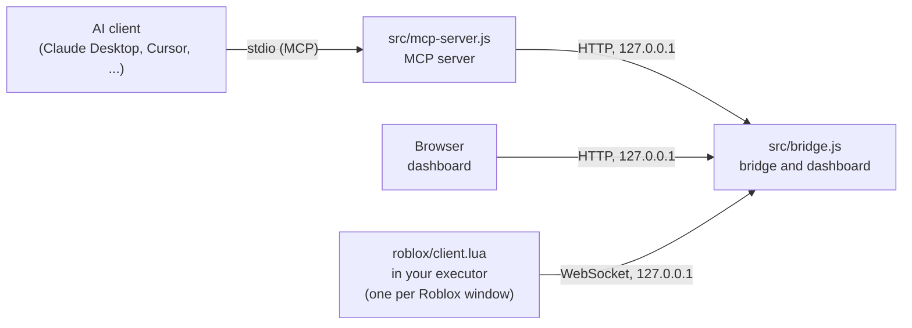

<p align="center">
  
</p>

<h1 align="center">Superbase</h1>

<p align="center">
  <strong>Let an AI assistant debug your live Roblox game.</strong>
</p>

Superbase is a local [Model Context Protocol](https://modelcontextprotocol.io) (MCP) server that connects AI assistants to running Roblox sessions through your executor. The AI can read the console and script errors, explore the instance tree with CSS-like selectors, read and search script sources, spy on remote calls, operate the GUI, take screenshots, change properties and run Lua. It always knows whether Roblox is actually connected, and you can watch everything in a local web dashboard.

- **Zero configuration.** No token, no account, no copy and paste. Start the bridge, run one line in your executor, add the MCP server to your AI client.
- **Connection aware.** Every tool result starts with a status line. When the game is not connected, the AI gets the exact script you need to run and tells you.
- **18 tools** for logs, errors, inspection, selectors, hierarchy trees, script listing and search, remote spying, GUI interaction, screenshots, properties and code execution.
- **Several Roblox windows at once.** Every client gets an id, and every tool takes a `client` argument to pick one.
- **Web dashboard.** Live logs, errors, a Lua console, an instance explorer and screenshots at `http://127.0.0.1:9731/`.
- **Works with any MCP client** that supports stdio servers: Claude Desktop, Claude Code, Cursor, Windsurf, VS Code, Codex CLI, Antigravity and more.
- **Local only.** Everything listens on `127.0.0.1`. Web pages cannot reach it.
- **No dependencies** in the MCP server. The bridge needs only [`ws`](https://github.com/websockets/ws).

> **Warning.** Superbase lets an AI run code inside your game with your executor's full permissions. Only connect AI clients you trust. See [Security](#security).

## Contents

- [How it works](#how-it-works)
- [Requirements](#requirements)
- [Quick start](#quick-start)
- [Connect your AI client](#connect-your-ai-client)
- [Example prompts](#example-prompts)
- [Tools reference](#tools-reference)
- [Selectors](#selectors)
- [Several Roblox windows](#several-roblox-windows)
- [Dashboard](#dashboard)
- [Connection states](#connection-states)
- [The in-game client](#the-in-game-client)
- [Executor functions](#executor-functions)
- [Configuration](#configuration)
- [Token mode](#token-mode)
- [HTTP API](#http-api)
- [Security](#security)
- [Project layout](#project-layout)
- [Development](#development)
- [Troubleshooting](#troubleshooting)
- [FAQ](#faq)
- [License](#license)

## How it works

Three small programs talk to each other on your computer, and your browser can join in:



| Part | Role |
| --- | --- |
| `roblox/client.lua` | Runs in your executor. Streams console output and script errors to the bridge and answers commands (run code, inspect, ping). |
| `src/bridge.js` | Keeps the connections to the games, stores the last 1,000 logs and 1,000 errors, and offers a local HTTP API. It also serves `client.lua` so you can load it with `loadstring`, the dashboard, and screenshots of the Roblox window. |
| `src/mcp-server.js` | Speaks MCP over stdio to your AI client and turns tool calls into bridge requests. It is started by the AI client, so you never run it by hand. |

Because the bridge stores logs, the AI can still read what happened after you leave the game.

## Requirements

- [Node.js](https://nodejs.org) 18 or newer
- A Roblox executor that supports `WebSocket.connect` and `loadstring`. Some features need more functions, see [Executor functions](#executor-functions).
- An AI client that supports MCP servers over stdio
- Windows for the `screenshot` tool. Everything else works on any system that runs Node.js.

## Quick start

**1. Install and start the bridge**

```bash
git clone https://github.com/fiangg20/superbase.git
cd superbase
npm install
npm start
```

The bridge prints the loader for your executor and the address of the dashboard:

```
[superbase] bridge 1.3.0 listening on ws://127.0.0.1:9731 (HTTP API on the same port)
[superbase] dashboard: http://127.0.0.1:9731/
[superbase] load the client in your executor with: loadstring(game:HttpGet("http://127.0.0.1:9731/client.lua"))()
```

**2. Load the client in your game**

Join a game and run this in your executor:

```lua
loadstring(game:HttpGet("http://127.0.0.1:9731/client.lua"))()
```

The intro plays, the console prints `[Superbase] Connected and authenticated` and a **Connected** notification appears in the top right corner.

If your executor blocks `HttpGet` to `localhost`, paste the contents of [`roblox/client.lua`](roblox/client.lua) into the executor instead.

**3. Add Superbase to your AI client**

Add the server to your client's MCP configuration (for Claude Desktop, see below for the other clients):

```json
{
  "mcpServers": {
    "superbase": {
      "command": "node",
      "args": ["C:\\path\\to\\superbase\\src\\mcp-server.js"]
    }
  }
}
```

Restart the client, then ask: *"Check the Roblox connection."* The AI calls `roblox_status` and answers.

You do not have to remember the loader line. While no game is connected, every tool result from the AI contains it, and the AI shows it to you. The dashboard shows it too.

## Connect your AI client

The command is always `node` with the absolute path to `src/mcp-server.js`. Use your own path in every example. If you changed the port, add `"env": { "SUPERBASE_PORT": "<port>" }`.

> The formats below follow each client's documented MCP configuration, which can change. If one does not work, check that client's own documentation.

<details>
<summary><strong>Claude Desktop</strong></summary>

Open **Settings → Developer → Edit Config**, or edit `claude_desktop_config.json` (on Windows usually in `%APPDATA%\Claude`). Restart Claude Desktop afterwards.

```json
{
  "mcpServers": {
    "superbase": {
      "command": "node",
      "args": ["C:\\path\\to\\superbase\\src\\mcp-server.js"]
    }
  }
}
```

If Claude Desktop keeps asking for permission, check the permission mode of the tool. Manual mode asks before every use of a new tool.

</details>

<details>
<summary><strong>Claude Code</strong></summary>

```bash
claude mcp add superbase -- node /path/to/superbase/src/mcp-server.js
```

</details>

<details>
<summary><strong>Cursor, Windsurf and Gemini CLI</strong></summary>

These clients use the same shape as Claude Desktop.

| Client | Config file |
| --- | --- |
| Cursor | `.cursor/mcp.json` (project) or `~/.cursor/mcp.json` (global) |
| Windsurf | `~/.codeium/windsurf/mcp_config.json` |
| Gemini CLI | `~/.gemini/settings.json` |

```json
{
  "mcpServers": {
    "superbase": {
      "command": "node",
      "args": ["/path/to/superbase/src/mcp-server.js"]
    }
  }
}
```

Since June 18, 2026 Gemini CLI no longer serves Google AI Pro, Ultra or free individual accounts. It still works with an API key or an enterprise license. Everyone else should use the Antigravity CLI.

</details>

<details>
<summary><strong>Antigravity</strong></summary>

Open the **…** menu at the top of the agent side panel, choose **MCP Servers**, then **Manage MCP Servers** and **View raw config**. That opens `mcp_config.json`. The documentation lists `~/.gemini/config/mcp_config.json` for all projects and `.agents/mcp_config.json` for a single workspace. In the Antigravity CLI, type `/mcp` to open the MCP manager, or edit the same file directly.

```json
{
  "mcpServers": {
    "superbase": {
      "command": "node",
      "args": ["/path/to/superbase/src/mcp-server.js"]
    }
  }
}
```

Click **Refresh** in Manage MCP Servers afterwards.

</details>

<details>
<summary><strong>VS Code</strong></summary>

Add this to `.vscode/mcp.json`:

```json
{
  "servers": {
    "superbase": {
      "type": "stdio",
      "command": "node",
      "args": ["/path/to/superbase/src/mcp-server.js"]
    }
  }
}
```

</details>

<details>
<summary><strong>Codex CLI</strong></summary>

Add this to `~/.codex/config.toml`:

```toml
[mcp_servers.superbase]
command = "node"
args = ["/path/to/superbase/src/mcp-server.js"]
```

</details>

**Clients that cannot use Superbase.** Superbase is local. Cloud hosted AI chats and mobile or web apps cannot reach `localhost`, so they cannot use it. An AI that has no MCP support but can run shell commands can use the [HTTP API](#http-api) directly.

## Example prompts

Once connected, you can ask things like:

- *"Check the Roblox connection."*
- *"Which game am I in, and who else is in the server?"*
- *"Show me the latest script errors and explain what causes them."*
- *"Print the hierarchy of Workspace, three levels deep."*
- *"Find every anchored Part inside Workspace.Map."*
- *"List every TextButton in my PlayerGui whose text contains `Buy`."*
- *"Search all scripts for `FireServer` and show me the lines around each match."*
- *"Start the remote spy, I will click the shop button, then show me which remotes were fired and with what arguments."*
- *"Click the Play button and tell me what the game printed."*
- *"Take a screenshot and describe what you see."*
- *"Read the source of `game.StarterPlayer.StarterPlayerScripts.CameraScript` and tell me what it does."*
- *"Set the Transparency of `game.Workspace.Door` to 0.5."*
- *"Run my code, then wait until the console prints `Loaded` and tell me what happened."*
- *"I have two Roblox windows open. Compare the player list of both."*

## Tools reference

Every result starts with a status line, for example:

```
[Superbase] ● connected — c1 (Player1), place 123456, executor_name 3.2, 12 ms
```

Tools marked **needs game** only run in the `connected` state. The others work as soon as the bridge is up, so the AI can still read stored logs and errors after you left the game.

Every tool that talks to the game accepts an optional `client` argument, the id of one Roblox window (see [Several Roblox windows](#several-roblox-windows)). Without it, the client that connected last is used.

### `roblox_status`

Pings the Roblox client and returns the connection state, the connected clients, place, executor, latency and the number of stored logs and errors. While `waiting_for_roblox` it also returns the `loader` script. Call it first. Optional: `client`.

### `list_clients`

Lists every connected Roblox client: id, player, place, server, executor, latency, and which one is the default.

### `get_game_info` · needs game

Place name and creator, job id, the local player, the player list (up to 50) and performance (physics FPS, memory, ping).

### `get_hierarchy` · needs game

Prints the instance tree under a path as an indented outline, like the Explorer panel. Good for getting to know a game quickly.

| Parameter | Type | Description |
| --- | --- | --- |
| `root` | string | Dotted path to start at. Default `game`. |
| `depth` | integer | 1–8. Default 3. |
| `max_nodes` | integer | 10–1000. Stops after this many lines. Default 300. |
| `max_children` | integer | 1–200. Most children shown per node. Default 40. |
| `class_name` | string | Only show the branches that lead to an instance of this class (base classes work). |

Example result:

```
Workspace [Workspace]
  Map [Model]
    Floor [Part]
    Spawn [SpawnLocation]
  Camera [Camera]
  ... 3 more children not shown
```

### `find_instances` · needs game

Searches the instance tree with a [selector](#selectors), or with the simple `name` and `class_name` filters. At least one of `selector`, `name` and `class_name` is required. Filters combine.

| Parameter | Type | Description |
| --- | --- | --- |
| `selector` | string | CSS-like selector, for example `Model > Part[Anchored=false]`. See [Selectors](#selectors). |
| `name` | string | Case-insensitive part of the instance name. |
| `class_name` | string | Class to match. Base classes work, for example `BasePart` or `LuaSourceContainer`. |
| `properties` | string[] | Up to 8 property names to return for every match. |
| `root` | string | Dotted path to search under. Default `game`. |
| `limit` | integer | Maximum results, 1–200. Default 50. |

Returns the full path and class of each match, the requested property values, and whether the list was cut off.

### `inspect_instance` · needs game

Reads one instance.

| Parameter | Type | Description |
| --- | --- | --- |
| `path` | string | Dotted path starting at `game`. Default `game`. |
| `properties` | string[] | Property names to read. Default `Name`, `ClassName`, `Parent`. |

Returns the class, the requested properties and up to 100 children.

### `list_scripts` · needs game

Lists the `Script`, `LocalScript` and `ModuleScript` instances with their path and class, and marks disabled ones.

| Parameter | Type | Description |
| --- | --- | --- |
| `root` | string | Dotted path to search under. Default `game`. |
| `class_name` | string | `Script`, `LocalScript` or `ModuleScript`. Default all. |
| `name` | string | Case-insensitive part of the script name. |
| `include_hidden` | boolean | Also list scripts outside the tree: nil parented instances, loaded modules and running scripts. Needs [executor functions](#executor-functions). Default `false`. |
| `limit` | integer | 1–500. Default 100. |

### `get_script_source` · needs game

Reads the source of a `Script`, `LocalScript` or `ModuleScript`. It uses the executor's `decompile` when available and falls back to the `Source` property. The source is returned as a plain code block.

| Parameter | Type | Description |
| --- | --- | --- |
| `path` | string | **Required.** Dotted path to the script. |
| `max_chars` | integer | 100–40000. Default 20000. Longer sources are cut and marked `truncated`. |

### `search_scripts` · needs game

Searches inside the source code of the scripts, like `grep`. It decompiles scripts one by one, which can be slow, so it stops after a time budget and reports how many scripts it searched.

| Parameter | Type | Description |
| --- | --- | --- |
| `query` | string | **Required.** What to look for. |
| `mode` | string | `text` (exact text, default), `pattern` (a [Lua pattern](https://www.lua.org/manual/5.3/manual.html#6.4.1), always case sensitive) or `words` (every word must appear, scripts are ranked by how often). |
| `case_sensitive` | boolean | Default `false`. |
| `root` | string | Dotted path to search under. Default `game`. |
| `class_name` | string | `Script`, `LocalScript` or `ModuleScript`. Default all. |
| `include_hidden` | boolean | Also search scripts outside the tree. Default `false`. |
| `context_lines` | integer | 0–3 lines of context around each match. Default 0. |
| `max_matches` | integer | 1–200. Default 40. |
| `max_scripts` | integer | 1–500 scripts to decompile. Default 150. |
| `budget_seconds` | integer | 2–60. Default 20. |

In `text` and `pattern` mode every matching line is returned with its script path and line number. In `words` mode every matching script is returned with its score and up to three sample lines. The result also has `searched`, `unreadable` (scripts that could not be decompiled), `timedOut` and `totalMatches`.

### `remote_spy` · needs game

Records the `RemoteEvent:FireServer` and `RemoteFunction:InvokeServer` calls that the game's own scripts make, with the arguments and the calling script. It hooks `__namecall`, so the executor needs [`hookmetamethod`](#executor-functions).

| Parameter | Type | Description |
| --- | --- | --- |
| `action` | string | **Required.** `start`, `get`, `stop`, `clear` or `status`. |
| `only` | string | `start`: only record remotes whose name contains this. |
| `ignore` | string[] | `start`: remote names to skip, for example noisy ones. |
| `max_calls` | integer | `start`: calls to keep, 50–2000. Default 500. |
| `include_own` | boolean | `start`: also record calls made by code run through Superbase. Default `false`. |
| `since_id` | integer | `get`: only calls after this id. Use `lastId` from the previous result. |
| `contains` | string | `get`: only calls whose remote name or arguments contain this. |
| `remote` | string | `get`: only calls to the remote with exactly this name. |
| `limit` | integer | `get`: 1–200, the newest are kept. Default 50. |

Typical use: `start`, make the action happen (click something in the game, or let the AI use `gui_interact`), then `get`, then `stop`. The hook stays installed until you leave the game, but it does nothing while stopped.

Each call looks like this:

```json
{
  "id": 12,
  "remote": "ReplicatedStorage.Shop.Buy",
  "className": "RemoteEvent",
  "method": "FireServer",
  "argCount": 2,
  "args": ["\"Sword\"", "3"],
  "caller": "Players.Me.PlayerGui.Shop.LocalScript"
}
```

### `gui_interact` · needs game

Looks at and operates the game's interface.

| Action | Parameters | What it does |
| --- | --- | --- |
| `list` | `root`, `kind` (`buttons`, `inputs`, `all`), `visible_only` (default `true`), `text`, `limit` | Lists buttons and text boxes with their text, real visibility and position. The default root is your `PlayerGui`. |
| `click` | `path`, `mode` | Presses a button. `signal` fires the button's own events, `mouse` sends a real mouse click at its center through `VirtualInputManager`, `auto` (default) tries the events first. |
| `set_text` | `path`, `text`, `submit` | Fills a text box. With `submit` it also presses Enter. |
| `trigger` | `path` | Fires a `ClickDetector` or a `ProximityPrompt`, given directly or found inside the part or model. |

Visibility takes every ancestor into account, so a button inside a hidden frame is reported as hidden.

### `screenshot`

Takes a screenshot of the Roblox window and returns it as an image, so the AI can see what you see. **Windows only.** It captures the real window on the computer that runs the bridge, so the window must be visible: not minimized and not covered by another window. It does not need the executor connection.

| Parameter | Type | Description |
| --- | --- | --- |
| `max_width` | integer | 320–1920. The image is scaled down to this width. Default 1280. |
| `focus` | boolean | Restore and raise the window before capturing. Default `false`. |

### `set_property` · needs game

Sets a property on an instance. This changes the game on your client, so it only replicates where Roblox allows it. Returns the old and the new value.

| Parameter | Type | Description |
| --- | --- | --- |
| `path` | string | **Required.** Dotted path to the instance. |
| `property` | string | **Required.** Property name, for example `Transparency`. |
| `value_json` | string | **Required.** The new value as JSON text. |

Supported values:

| Value | `value_json` |
| --- | --- |
| String | `"\"Hello\""` |
| Number | `"0.5"` |
| Boolean | `"false"` |
| `Vector3` | `{"type":"Vector3","x":1,"y":2,"z":3}` |
| `Vector2` | `{"type":"Vector2","x":1,"y":2}` |
| `Color3` (0–255) | `{"type":"Color3","r":255,"g":0,"b":0}` |
| `Enum` | `{"type":"Enum","enum":"Material","name":"Neon"}` |
| Instance | `{"type":"Instance","path":"game.Workspace.Part"}` |

`null` is not accepted. Use `execute_lua` to set a property to `nil`.

### `execute_lua` · needs game

Runs Lua in the executor and returns the serialized return values, or the error with a traceback.

| Parameter | Type | Description |
| --- | --- | --- |
| `code` | string | **Required.** Lua source. Use `return` to get a value back. |
| `capture_logs` | boolean | Also return the console lines and script errors produced during the run. Default `false`. |
| `wait_ms` | integer | With `capture_logs`: how long to keep collecting after the code finished, 0–5000. Default 500. |
| `timeout_ms` | integer | How long to wait for the code to finish, 1000–120000. Default 15000. |

Tables are serialized up to 6 levels deep and 200 entries per table. Strings are cut at 60,000 characters.

### `get_logs`

Reads stored console output. The newest entries come last. The result contains a `now` timestamp you can pass as `since` next time. Every entry has the `client` that sent it.

| Parameter | Type | Description |
| --- | --- | --- |
| `limit` | integer | 1–1000. Default 100. |
| `level` | string | `info`, `warn` or `error`. |
| `contains` | string | Case-insensitive text filter. |
| `since` | integer | Only entries from this timestamp (milliseconds) onward. |
| `client` | string | Only entries from this client. Default all clients. |

### `get_errors`

Reads stored script errors with the stack trace and the script path.

| Parameter | Type | Description |
| --- | --- | --- |
| `limit` | integer | 1–1000. Default 50. |
| `contains` | string | Case-insensitive filter on the message and the trace. |
| `since` | integer | Only errors from this timestamp (milliseconds) onward. |
| `client` | string | Only errors from this client. Default all clients. |

### `wait_for_log`

Waits until a **new** console line (or script error) that contains some text appears, then returns it. Lines that were already stored when the call started do not count. A timeout is a normal result (`matched: false`), not an error.

| Parameter | Type | Description |
| --- | --- | --- |
| `contains` | string | **Required.** Text to wait for. |
| `timeout_ms` | integer | 100–30000. Default 10000. |
| `level` | string | Only match console lines of this level. |
| `include_errors` | boolean | Also match script errors. Default `true`. |
| `client` | string | Only match lines from this client. Default all clients. |

### `clear_logs`

Clears the stored logs and errors. Optional: `client` clears only the entries of that client.

### Limits

| Limit | Value |
| --- | --- |
| Stored logs / errors | 1,000 each (oldest are dropped) |
| Command timeout | 15 seconds, up to 120 seconds with `timeout_ms` |
| Ping timeout | 3 seconds |
| Result size shown to the AI | 50,000 characters |
| Selector | 500 characters, 8 steps, 6 attributes per step |
| Instance names | Names that contain a `.` cannot be addressed by path |

## Selectors

`find_instances` understands a small CSS-like language, so the AI can ask for exactly what it wants in one call.

| Syntax | Meaning |
| --- | --- |
| `Part` | Instances of that class. Base classes match too, so `BasePart` finds every part type. |
| `*` | Any instance. |
| `#Spawn`, `#'Spawn Point'` | Instances with exactly that name. |
| `A B` | `B` anywhere below `A`. |
| `A > B` | `B` directly inside `A`. |
| `> A` | A direct child of the search root. |
| `[Prop]` | The property is set (not `nil`, `false`, `0` or an empty string). |
| `[Prop=value]`, `[Prop!=value]` | Equal, not equal. |
| `[Prop*=text]`, `[Prop^=text]`, `[Prop$=text]` | Contains, starts with, ends with. |
| `[Prop<n]`, `[Prop<=n]`, `[Prop>n]`, `[Prop>=n]` | Numeric comparison. |

Parts combine: `TextButton#Play[Visible=true]`. Values can be quoted (`'it\'s'`), numbers, `true`, `false` or bare words. Enum values compare by name (`[Material=Neon]`), instances by full name. A property that does not exist never matches, and Roblox attributes work as properties.

Examples:

```
RemoteEvent
Model > Part
Part[Anchored=false]
TextButton#Play
Frame TextLabel[Text*='coins']
> Workspace > Map
Part[Transparency>=0.5][Name^=Glass]
```

A wrong selector returns an error that says where the problem is, for example `Expected ']' at position 18 of "Part[Anchored=true"`.

## Several Roblox windows

You can run Superbase in several Roblox windows or with several accounts at the same time. Each one connects to the same bridge and gets an id in the order it connected: `c1`, `c2` and so on.

- `list_clients` and the dashboard show every client with its player, place, executor and latency.
- Without a `client` argument, commands go to the client that connected last.
- With `"client": "c1"`, the command goes to that window. An unknown id gives a clear error and lists the connected clients.
- Logs and errors are tagged with the client that sent them. Filter with the `client` argument of `get_logs`, `get_errors`, `wait_for_log` and `clear_logs`.
- Running the loader again in the same game replaces the old connection of that player in that server instead of adding a second one.
- If one window closes, only the commands waiting for that window fail. The others keep working.

The AI is told to pass a `client` id whenever more than one client is connected and it is not clear which one you mean.

## Dashboard

Open `http://127.0.0.1:9731/` while the bridge runs. It works in any browser on the same computer, in a light and a dark theme, and on a narrow screen.

| Tab | What it does |
| --- | --- |
| Clients | Shows every connected Roblox window. Pick one, or leave it on automatic. While nothing is connected it shows the loader line with a copy button. |
| Logs | Live console output with level and text filters, pause, follow and clear. |
| Errors | Script errors with their stack trace, with a filter and clear. |
| Run Lua | A code box that runs on the selected client (Ctrl+Enter), with a timeout and a list of recent code. |
| Explorer | Browse the instance tree by path or by clicking, and read properties. |
| Screenshot | Capture the Roblox window, also every 3 seconds, and download the image. Windows only. |

The page itself contains no data. It reads everything through the same API as the MCP server, with the same checks. In [token mode](#token-mode) it asks for the token once and keeps it for that browser tab only.

## Connection states

The AI always knows which state it is in, because the first line of every result shows it.

| State | Status line | Meaning | What the AI does |
| --- | --- | --- | --- |
| `connected` | `●` | A client is connected and answered a ping. | Everything works. |
| `waiting_for_roblox` | `○` | The bridge runs, but no game is connected. | Shows you the `loadstring` script and waits. |
| `unresponsive` | `○` | A client is connected but did not answer a ping. | Tells you the game may be frozen, loading or closing. |
| `unknown_client` | `○` | The `client` id that was asked for is not connected. | Calls `list_clients` and picks one. |
| `bridge_offline` | `○` | The bridge is not running. | Asks you to run `npm start`. |
| `token_mismatch` | `○` | The bridge needs a token and the MCP config has none, or a different one. | Asks you to fix `BRIDGE_TOKEN` in the MCP config. |

When the state is not `connected`, tools that need the game are not run, and the AI is told not to retry in a loop.

The bridge pings every client every 10 seconds and drops one after 30 seconds of silence, so a force closed game does not look connected.

## The in-game client

`roblox/client.lua` does more than relay messages.

**Intro.** A short animated intro plays when the client starts. It does not delay the connection.

**Notifications.** Small toasts appear in the top right corner:

| Notification | When |
| --- | --- |
| Connected / Reconnected | The bridge accepted the client. |
| Disconnected | The connection was lost. The client keeps retrying. |
| Bridge not found | The bridge is not running. Shown once, not on every retry. |
| Bridge closed the connection | Usually a token problem. |
| AI activity | The AI ran code or inspected an instance (at most once every 3 seconds). |

Toasts wait for the intro to finish.

**Identity.** The client tells the bridge your player name and user id, so you can tell several windows apart.

**Re-running is safe.** Running the script again stops the previous instance first (including the older DebugBridge build), so connections do not stack.

### Client settings

Edit the `CONFIG` table at the top of `roblox/client.lua`.

| Option | Default | Description |
| --- | --- | --- |
| `Url` | `ws://127.0.0.1:9731` | Bridge address. The loader from the bridge already has the right port. |
| `Token` | `""` | Only needed in [token mode](#token-mode). |
| `ReconnectDelay` | `3` | Seconds between reconnect attempts. |
| `Notifications` | `true` | Show status notifications. |
| `NotifyActivity` | `true` | Also notify when the AI runs code or inspects something. |
| `ActivityCooldown` | `3` | Minimum seconds between activity notifications. |
| `ToastTime` | `4` | Seconds a notification stays on screen. |
| `MaxToasts` | `4` | Notifications visible at once. |
| `Intro.Enabled` | `true` | Play the intro. |
| `Intro.*` | | Icon, color, timing, blur and swipe settings of the intro. |
| `HistoryLines` | `100` | Console history sent when connecting. |
| `MaxMessageLength` | `4000` | Longest console message sent. |
| `MaxResultLength` | `60000` | Longest string returned from `execute_lua`. |
| `MaxTableEntries` / `MaxDepth` | `200` / `6` | Limits when serializing tables. |

## Executor functions

The basics need only `WebSocket.connect` and `loadstring`. Some tools use more functions. Executors differ, so a tool reports a clear error when a function it needs is missing, and the client falls back where it can.

| Tool | Uses | Without it |
| --- | --- | --- |
| `get_script_source`, `search_scripts` | `decompile` | Falls back to the `Source` property, which is often not readable. |
| `list_scripts`, `search_scripts` with `include_hidden` | `getnilinstances`, `getloadedmodules`, `getscripts` | Those sources are skipped and the result says which function is missing. |
| `remote_spy` | `hookmetamethod`, `getnamecallmethod` (and optionally `newcclosure`, `setnamecallmethod`, `checkcaller`, `getcallingscript`) | Cannot start. |
| `gui_interact` `click` | `getconnections` or `firesignal`, or `VirtualInputManager` for `mode: "mouse"` | Cannot click. |
| `gui_interact` `trigger` | `fireclickdetector`, `fireproximityprompt` | Cannot trigger that kind of object. |
| Executor name in the status line | `identifyexecutor` | Shown as unknown. |

## Configuration

Environment variables. Set them for the process that uses them: the bridge is started by you, the MCP server by your AI client (use the `env` field of its config).

| Variable | Used by | Default | Description |
| --- | --- | --- | --- |
| `SUPERBASE_PORT` (or `BRIDGE_PORT`) | bridge, MCP server | `9731` | Port of the bridge. Must be the same for both. |
| `SUPERBASE_TOKEN` (or `BRIDGE_TOKEN`) | bridge, MCP server | none | Enables [token mode](#token-mode). At least 16 characters. |
| `SUPERBASE_CLIENT_URL` | MCP server | the bridge's `/client.lua` | URL used in the `loadstring` script, for example a public raw GitHub link. |
| `SUPERBASE_PING_MS` | bridge | `10000` | Heartbeat interval. |
| `SUPERBASE_STALE_MS` | bridge | `30000` | Drop a client that was silent this long. |

To change the port, set `SUPERBASE_PORT` when you start the bridge and in the `env` of your MCP config, then use the loader the bridge prints. Example for PowerShell: `$env:SUPERBASE_PORT="9800"; npm start`.

## Token mode

By default the bridge needs no token. If you want one anyway, for example because other programs run on your computer that you do not trust:

1. Generate a token: `node -e "console.log(require('crypto').randomBytes(24).toString('hex'))"`
2. Start the bridge with it. PowerShell: `$env:BRIDGE_TOKEN="<token>"; npm start`. macOS or Linux: `BRIDGE_TOKEN=<token> npm start`.
3. Add it to your MCP config: `"env": { "BRIDGE_TOKEN": "<token>" }`.
4. Copy `roblox/client.lua` into your executor and set `CONFIG.Token` to the same token.

In token mode `/client.lua` is not served, so there is no `loadstring` loader. The dashboard asks for the token when you open it. Never commit a real token.

## HTTP API

The MCP server and the dashboard use this API, and so can your own tools. In open mode every request needs a header named `x-superbase-client` (any value). In token mode it needs `x-bridge-token: <token>` instead. `GET /`, `GET /icon.png` and `GET /client.lua` need neither.

| Request | Purpose |
| --- | --- |
| `GET /` | The dashboard page. It holds no data. |
| `GET /client.lua` | The executor client with its URL set to this bridge. Open mode only. |
| `GET /status` | Connection info. Query: `probe=1` pings the client first, `client` selects one. |
| `GET /clients` | The connected clients. |
| `GET /logs` | Stored console output. Query: `limit`, `level`, `contains`, `since`, `client`. Every entry has an `id` and a `client`. |
| `GET /errors` | Stored script errors. Query: `limit`, `contains`, `since`, `client`. |
| `POST /exec` | Run Lua. Body: `{ "code": "return 1", "client": "c1", "timeout_ms": 15000 }`. `client` and `timeout_ms` are optional. |
| `POST /inspect` | Inspect an instance. Body: `{ "path": "game.Workspace", "properties": ["Name"], "client": "c1" }`. |
| `POST /clear` | Clear stored logs and errors. Body: `{ "client": "c1" }` clears one client, `{}` clears all. |
| `GET /screenshot` | Screenshot of the Roblox window as base64 JPEG. Query: `max_width`, `focus=1`. Windows only. |

Example:

```bash
curl -H "x-superbase-client: curl" "http://127.0.0.1:9731/status?probe=1"
```

## Security

Superbase gives an AI the same power over your game client as your executor has. Read this section before you use it.

- **Code execution.** `execute_lua`, `set_property` and `gui_interact` run code inside your executor. Review what the AI wants to run before you approve it, and only connect clients you trust.
- **Local only.** The bridge binds to `127.0.0.1`. Never expose the port to a network or the internet.
- **Web pages are blocked.** The bridge checks the `Host` header, rejects any HTTP request or WebSocket connection that carries a foreign `Origin`, never approves a CORS preflight and requires a custom header on every API call. A web page you visit cannot reach it. The dashboard is served with a strict Content Security Policy and cannot be embedded in another page, and it shows log text as plain text only.
- **Other programs are not blocked in open mode.** Without a token, any program running on your computer can use the bridge. Use [token mode](#token-mode) if that matters to you.
- **Remote spy sees private data.** Remote calls can contain chat messages and other personal data of the game. The recorded calls stay in the memory of your executor, up to `max_calls`, and are sent to your AI client when it reads them.
- **Screenshots capture pixels.** The `screenshot` tool copies the screen area of the Roblox window, so anything that covers the window is captured too. The image goes to your AI client.
- **Keep tokens private.** Anyone who has the token and can reach the port can run code in your game. Never commit one.
- **Use it in your own games.** Running code in other people's games can break their rules. You are responsible for where you use Superbase.

## Project layout

```
superbase/
├── src/
│   ├── bridge.js           WebSocket server, local HTTP API, dashboard host
│   ├── mcp-server.js       MCP server (stdio), no dependencies
│   ├── dashboard.html      The web dashboard (one file, no build step)
│   ├── selector.js         Parser for the find_instances selector language
│   ├── screenshot.js       Windows window capture used by the bridge
│   └── lua/                Lua snippets behind the higher level tools
│       ├── game_info.lua
│       ├── find_instances.lua
│       ├── get_hierarchy.lua
│       ├── list_scripts.lua
│       ├── get_script_source.lua
│       ├── search_scripts.lua
│       ├── remote_spy.lua
│       ├── gui_interact.lua
│       └── set_property.lua
├── roblox/
│   └── client.lua          Runs in the executor
├── assets/
│   └── icon.png
├── test/
│   ├── bridge.test.js
│   ├── mcp-server.test.js
│   ├── selector.test.js
│   ├── screenshot.test.js
│   ├── lua.test.js
│   ├── lua-runtime.test.js
│   └── lua/                Mock of the Roblox API for the snippet tests
├── package.json
└── README.md
```

## Development

```bash
npm install
npm test
```

The tests start the bridge, the MCP server and fake executors. They cover every connection state, every tool, several clients at once, timeouts, the open and token modes and the protection against web pages. Separate tests cover the selector parser, the screenshot module (with a fake PowerShell) and static checks of the Lua files.

The Lua snippets in `src/lua` also run against a small mock of the Roblox API (`test/lua`). That test needs a Lua 5.3 or newer interpreter (for example `lua5.4`) and is skipped when none is installed. The mock checks the logic of the snippets, not how a real executor behaves, so test changes to `roblox/client.lua` and `src/lua` in a game. The Windows screenshot capture also needs a manual test on Windows.

To add a tool that runs Lua in the game, put the code in `src/lua/<name>.lua` (it receives its arguments as a table named `args` and returns a table, or `{ error = "..." }` to fail), then add the tool definition in `src/mcp-server.js` and call `runSnippet("<name>", args, context)`.

### Compatibility notes

- The MCP server targets protocol versions 2025-06-18, 2025-03-26 and 2024-11-05.
- Executors differ. `decompile`, `identifyexecutor` and the WebSocket API are optional or named differently in some of them, and the client falls back where it can. See [Executor functions](#executor-functions).

## Troubleshooting

| Symptom | Cause and fix |
| --- | --- |
| `Cannot find module 'ws'` | Run `npm install` in the Superbase folder. |
| The loader fails in the executor | The executor may block `HttpGet` to `localhost`. Paste `roblox/client.lua` into the executor instead. |
| Executor console shows `401 Unauthorized`, or a "Bridge closed the connection" notification | The bridge was started with `BRIDGE_TOKEN`. Set `CONFIG.Token` in `client.lua` to the same value, or restart the bridge without a token. |
| `Unable to connect`, or a "Bridge not found" notification | The bridge is not running, or the port differs from `CONFIG.Url`. |
| The port is already in use | Pick another port: set `SUPERBASE_PORT` for the bridge and the MCP server, then use the loader the bridge prints. |
| The AI says `bridge_offline` | Start the bridge with `npm start`. |
| The AI says `waiting_for_roblox` | The client stops when you leave or rejoin a game. Run the loader again, or put it in your executor's autoexec folder. |
| The AI says `unresponsive` | The game is frozen, still loading or closing. Wait, or rejoin and run the loader again. |
| The AI says `unknown_client` | That client id is gone, for example after the window closed or the loader ran again. Use `list_clients`. |
| The AI says `token_mismatch` | The MCP config token and the bridge token differ. Make them the same, or run the bridge without a token. |
| `remote_spy` says the executor has no `hookmetamethod` | Your executor does not support hooking metamethods, so the remote spy cannot run. |
| `gui_interact` cannot click a button | The button may have no connections to fire. Try `"mode": "mouse"`, which needs the button to be visible. |
| `search_scripts` finds nothing or reports many `unreadable` scripts | The decompiler failed or timed out. Narrow it with `root` or `class_name`, raise `budget_seconds`, or try again later. |
| `screenshot` says it is only supported on Windows | The bridge runs on another system. Screenshots need Windows. |
| `screenshot` says no Roblox window was found, or that it is minimized | Start the game, or restore the window. `"focus": true` restores and raises it. |
| The dashboard says it cannot reach the bridge | The bridge is not running. Start it with `npm start`. The page reconnects by itself. |
| The AI client does not list Superbase | Check the path in the config, restart the client and confirm that Node.js 18+ is installed (`node --version`). |
| Claude Desktop asks for confirmation on every call | The tool permission mode is set to ask. Change it in the tool's permission settings. |

## FAQ

**Do I need Claude Code?**
No. Any MCP client that supports stdio servers works.

**Does it work from my phone?**
No. The MCP server runs on your computer, so the AI client must run there too. Mobile and web apps cannot reach `localhost`.

**Can I use two Roblox windows at once?**
Yes. Each window gets its own client id. See [Several Roblox windows](#several-roblox-windows).

**Do I need a token?**
No. Open mode works without one and still blocks web pages. Use [token mode](#token-mode) if you want other programs on your computer to be locked out as well.

**Can it change things on the server?**
Not by itself. Code runs on your client. Server side effects are possible only where the game itself exposes them, for example through a RemoteEvent that you own and that accepts code, which is your decision in your own game.

**Does it work in every game?**
It works wherever your executor can run scripts. Some games detect or block executors, and that is outside the control of Superbase.

**Is it affiliated with Roblox?**
No. Superbase is an independent project.

## License

Superbase is released under the [MIT License](LICENSE). You may use, copy, modify and distribute it, including in commercial projects, as long as the copyright notice and the license text stay with it. The software comes without any warranty. You are responsible for where and how you use it, see [Security](#security).

Superbase is an independent project and is not affiliated with Roblox.

[](https://m8ven.ai/mcp/fiangg20-superbase-1nmxtn?s=readme)
