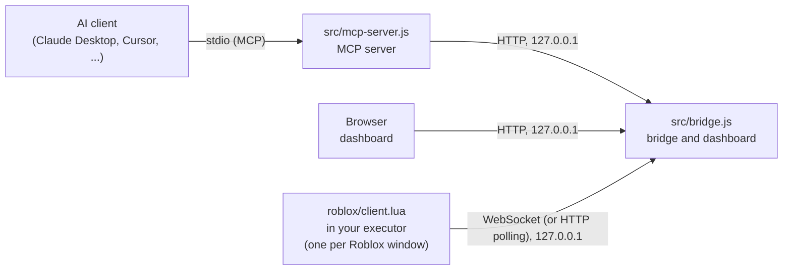

<p align="center">
  
</p>

<h1 align="center">Superbase</h1>

<p align="center">
  <strong>Let an AI assistant debug your live Roblox game.</strong>
</p>

<div align="center">

[](https://m8ven.ai/verified?check=https%3A%2F%2Fgithub.com%2Ffiangg20%2Fsuperbase) [](https://glama.ai/mcp/servers/fiangg20/superbase) [](https://mcp.liqiwa.com/s/fiangg20--superbase.html) [](https://saweria.co/bases)

</div>

Superbase is a local [Model Context Protocol](https://modelcontextprotocol.io) (MCP) server that connects AI assistants to running Roblox sessions through your executor. The AI can read the console and script errors, explore the instance tree with CSS-like selectors, read and search script sources, spy on remote calls, operate the GUI, take screenshots, see the players, move the character, measure performance, compare snapshots of the game, change properties and run Lua. It always knows whether Roblox is actually connected, and you can watch everything in a local web dashboard.

- **One command to set up.** `npm run setup` installs the one dependency and registers the MCP server in your AI clients. There is no separate `npm install` step, and you do not have to run `npm start`: the bridge starts by itself when the AI needs it. `npm start` is still there when you want to run the bridge yourself.
- **Connection aware.** Every tool result starts with a status line. When the game is not connected, the AI gets the exact script you need to run and tells you.
- **30 tools** for logs, errors, inspection, selectors, hierarchy trees, script listing, text search and search by meaning, reverse engineering (upvalues, constants, the garbage collector, signal handlers, an HTTP spy), remote spying, blocking and firing, GUI interaction, screenshots, players and characters, performance stats, snapshots and diffs, saved and shared Lua recipes, properties and code execution. Plus six [prompts](#prompts) and a [safe mode](#safe-mode) that turns off everything that changes the game.
- **Teleports.** The executor forgets a script when the game teleports you, and Superbase does not use `queue_on_teleport`. With the loader in your executor's autoexec folder (`npm run autoexec`) the client comes back in every new place by itself. Without it, run the loader again after a teleport.
- **Works on more executors.** No WebSocket? The client falls back to HTTP long polling. `HttpGet` blocked? The loader uses the executor's `request` function. It can also install itself into your executor's autoexec folder.
- **Several Roblox windows at once.** Every client gets an id, and every tool takes a `client` argument to pick one.
- **Web dashboard.** Live logs, errors, a Lua console, an instance explorer and screenshots at `http://127.0.0.1:9731/`.
- **Works with any MCP client** that supports stdio servers: Claude Desktop, Claude Code, Cursor, Windsurf, VS Code, Codex CLI, Antigravity, Cline, Roo Code, Kiro, Qwen Code, OpenCode and more.
- **Local by default.** Everything listens on `127.0.0.1` and web pages cannot reach it. If you want the executor, the bridge and the AI on different computers, the `host` setting opens it to your network, and then a token is required. See [Several computers](#several-computers).
- **Free and open source.** MIT licensed. The MCP server has no dependencies, the bridge needs only [`ws`](https://github.com/websockets/ws), and the optional semantic search runs on your own [Ollama](https://ollama.com).

> **Warning.** Superbase lets an AI run code inside your game with your executor's full permissions. Only connect AI clients you trust. See [Security](#security).

## Contents

- [How it works](#how-it-works)
- [Requirements](#requirements)
- [Quick start](#quick-start)
- [One line install](#one-line-install)
- [Connect your AI client](#connect-your-ai-client)
- [Example prompts](#example-prompts)
- [Tools reference](#tools-reference)
- [Selectors](#selectors)
- [Several Roblox windows](#several-roblox-windows)
- [Dashboard](#dashboard)
- [Recipes](#recipes)
- [Prompts](#prompts)
- [Loader and autoexec](#loader-and-autoexec)
- [Executors without WebSocket](#executors-without-websocket)
- [Several computers](#several-computers)
- [Semantic search](#semantic-search)
- [Connection states](#connection-states)
- [The in-game client](#the-in-game-client)
- [Executor functions](#executor-functions)
- [Configuration](#configuration)
- [Running the bridge in the background](#running-the-bridge-in-the-background) (with the [tray icon](#tray-icon-windows))
- [Updates](#updates)
- [Token mode](#token-mode)
- [HTTP API](#http-api)
- [Safe mode](#safe-mode)
- [Security](#security)
- [Project layout](#project-layout)
- [Fonts and icons](#fonts-and-icons)
- [Development](#development)
- [Troubleshooting](#troubleshooting)
- [FAQ](#faq)
- [Support](#support)
- [License](#license)
- [Credits](#credits)

## How it works

Three small programs talk to each other on your computer, and your browser can join in:



| Part | Role |
| --- | --- |
| `roblox/client.lua` | Runs in your executor. Streams console output and script errors to the bridge and answers commands (run code, inspect, ping). It uses WebSocket and falls back to HTTP long polling. |
| `roblox/loader.lua` | Optional. Downloads and runs the client, with a retry loop. Use it when `HttpGet` is blocked, or put it in your autoexec folder. |
| `src/bridge.js` | Keeps the connections to the games, stores the last 1,000 logs and 1,000 errors, and offers a local HTTP API. It also serves `client.lua` so you can load it with `loadstring`, the dashboard, and screenshots of the Roblox window. |
| `src/mcp-server.js` | Speaks MCP over stdio to your AI client and turns tool calls into bridge requests. It is started by the AI client, so you never run it by hand. |

Because the bridge stores logs, the AI can still read what happened after you leave the game.

## Requirements

- [Node.js](https://nodejs.org) 18 or newer
- A Roblox executor that supports `loadstring` and either `WebSocket.connect` or an HTTP request function (`request`, `http_request`, `syn.request`). Some features need more functions, see [Executor functions](#executor-functions).
- An AI client that supports MCP servers over stdio
- Windows for the `screenshot` tool. Everything else works on any system that runs Node.js.

## Quick start

**1. Set up**

```bash
git clone https://github.com/fiangg20/superbase.git
cd superbase
npm run setup
```

No git? Download the ZIP from the GitHub page, unzip it, open a terminal in the folder and run `npm run setup`.

That is all. `npm run setup` installs the dependency, finds your AI clients and registers the MCP server in them. You do not need `npm install`, and `npm start` is optional: when the AI calls a tool and no bridge is running, the MCP server starts one in the background and tells the AI (and so you) that it did. At the end the setup prints the line to run in your executor, and offers to put the loader in your executor's autoexec folder, so the executor loads Superbase by itself in every game (see [Loader and autoexec](#loader-and-autoexec)).

Restart your AI client once so it loads the change.

**Running the bridge yourself (optional).** `npm start` runs the bridge in your terminal. It is the way to go when you want to watch every event live, see the styled screen, start it before the AI does, use a [token](#token-mode), another port or a [network address](#several-computers), or when you simply prefer to control it by hand. It prints this:

```
  ╭────────────────────────────────────────────╮
  │  Superbase Bridge 1.4.1                    │
  │  Roblox executor and AI, connected         │
  ╰────────────────────────────────────────────╯

  ● Running     ws://127.0.0.1:9731
  ● Dashboard   http://127.0.0.1:9731/
  ● Mode        open (no token, web pages are blocked)

  Load this in your executor
    loadstring(game:HttpGet("http://127.0.0.1:9731/client.lua"))()

  Waiting for a Roblox client. Press Ctrl+C to stop.

  12:55:07  ✔ executor connected as c1 (placeId=123, executor=Athena, user=Tester)
```

Every event after that gets one line with the time: a client that connects, disconnects or stops responding, and rejected connections. If the port is already taken, the bridge says so and prints the command for another port.

When the output goes to a file or a pipe, or when `SUPERBASE_PLAIN=1` is set, the bridge prints plain `[superbase] ...` lines without colors. `NO_COLOR=1` keeps the layout and removes only the colors. See [Running the bridge in the background](#running-the-bridge-in-the-background).

**2. Load the client in your game**

Join a game and run this in your executor:

```lua
loadstring(game:HttpGet("http://127.0.0.1:9731/client.lua"))()
```

The intro plays (the first time only), the console prints `[Superbase] Connected and authenticated` and a **Connected** notification appears in the top right corner.

If your executor blocks `HttpGet` to `localhost`, use the [loader](#loader-and-autoexec) instead (`npm run loader`), or paste the contents of [`roblox/client.lua`](roblox/client.lua) into the executor.

**3. Add Superbase to your AI client**

`npm run setup` (step 1) already did this. The [one line install](#one-line-install) does the same without a clone. To do it by hand, add the server to your client's MCP configuration (for Claude Desktop, see below for the other clients):

```json
{
  "mcpServers": {
    "superbase": {
      "command": "node",
      "args": ["C:\\path\\to\\superbase\\src\\mcp-server.js"]
    }
  }
}
```

Restart the client, then ask: *"Check the Roblox connection."* The AI calls `roblox_status` and answers.

You do not have to remember the loader line. While no game is connected, every tool result from the AI contains it, and the AI shows it to you. The dashboard shows it too.

## One line install

The installer downloads Superbase, installs the one dependency and registers the MCP server in every supported AI client it finds on your computer, so you do not edit any config file by hand.

**Windows (PowerShell)**

Download the installer to a file, then run it. This avoids the `irm ... | iex` pattern, which some antivirus programs flag on sight (see the note below).

```powershell
irm https://raw.githubusercontent.com/fiangg20/superbase/main/install.ps1 -OutFile "$env:TEMP\superbase-install.ps1"
powershell -NoProfile -ExecutionPolicy RemoteSigned -File "$env:TEMP\superbase-install.ps1"
```

**macOS and Linux**

```bash
curl -fsSL https://raw.githubusercontent.com/fiangg20/superbase/main/install.sh | sh
```

Running a downloaded script runs whatever it contains, so read [`install.ps1`](install.ps1), [`install.sh`](install.sh) and [`scripts/install.js`](scripts/install.js) first if you want to know what happens. They are short.

**Antivirus note.** The one line form `powershell -ExecutionPolicy Bypass -Command "irm <url> | iex"` downloads and runs code in one step, which is exactly what real malware does too, so Microsoft Defender can flag the command line itself with a machine learning detection (for example `Trojan:Win32/Commando.A!ml`) even though the script is harmless. That is why the Windows command above downloads the file first. If you want to avoid scripts entirely, clone the repository (or download the ZIP from GitHub and unzip it) and run `npm run setup` inside the folder, as in the [Quick start](#quick-start). If Defender still flags it, check the alert, read the script, and report the detection as a false positive to Microsoft at https://www.microsoft.com/en-us/wdsi/filesubmission.

The bootstrap script checks for Node.js 18 or newer, downloads the code into `%LOCALAPPDATA%\Superbase` (`~/.superbase` on macOS and Linux), runs `npm install` and then runs `scripts/install.js`. That script shows the clients it found as a checklist (arrow keys to move, space to tick, `a` for all, enter to confirm) and writes nothing before you confirm. Clients that are not installed are listed too, but unticked. Before it registers anything it installs the dependency (`npm install`) when `node_modules` is missing, so the server starts on the first try.

If you already cloned the repository, run the last step yourself. It installs the dependency too:

```bash
npm run setup
```

To take Superbase out of your AI clients again:

```bash
npm run delete
```

`npm run delete` shows the same checklist and removes only the `superbase` entry from the clients you confirm. Your other servers and settings stay, and a backup is made first. It does not delete the Superbase folder, remove it yourself when you no longer need it.

Supported clients: Claude Desktop (including the Microsoft Store version), Claude Code, Cursor, Windsurf, VS Code, VS Code Insiders, Cline, Roo Code, Gemini CLI, Antigravity, Qwen Code, Kiro, OpenCode and Codex CLI.

What the installer does and does not do:

- Every config file is copied to `<file>.superbase-backup-<date>` before it changes. Your other servers and settings stay as they are.
- It only edits plain JSON and TOML. A file with comments or a shape it does not expect (for example `opencode.jsonc`) is left alone and reported, and you add the entry by hand from the section below.
- Running it again changes nothing when the entry is already correct, and updates the path when the folder moved.
- It cannot know about every client. For any other JSON file use `--file`, for example `node scripts/install.js --file path\to\mcp.json --key mcpServers`.

Options for `scripts/install.js`:

| Option | Meaning |
|---|---|
| `--yes`, `-y` | Register in every client that was found without asking. |
| `--list` | Only show which clients were found. |
| `--dry-run` | Show what would change and write nothing. |
| `--uninstall` | Remove the `superbase` entry again (`npm run delete`, same as `npm run uninstall-mcp`). |
| `--client a,b` | Only these clients, by id (`claude-desktop`, `claude-code`, `cursor`, `windsurf`, `vscode`, `vscode-insiders`, `cline`, `roo-code`, `gemini-cli`, `antigravity`, `qwen-code`, `kiro`, `opencode`, `codex`). |
| `--file <path>` | Edit one JSON file of your choice. Use `--key` (default `mcpServers`) and `--shape standard\|vscode\|opencode`. |
| `--port <n>` | Set `SUPERBASE_PORT` for the MCP server, when the bridge does not use 9731. |
| `--node <command>` | The command that starts Node.js (default `node`). Use a full path when `node` is not on the PATH of the client. |
| `--no-deps` | Do not run `npm install` when the dependency is missing. |
| `--plain` | No colors and no checklist, only plain lines. This is also used when the output is not a terminal. |
| `--print` | Print the snippets for manual setup and exit. |

The bootstrap scripts read these environment variables: `SUPERBASE_DIR` (install folder), `SUPERBASE_REF` (branch or tag), `SUPERBASE_ARGS` (options for `scripts/install.js`, for example `--yes`) and `SUPERBASE_START=1` (start the bridge at the end). Restart the AI client after the installer ran, then start the bridge with `npm start`.

## Connect your AI client

The command is always `node` with the absolute path to `src/mcp-server.js`. Use your own path in every example. If you changed the port, add `"env": { "SUPERBASE_PORT": "<port>" }`.

> The formats below follow each client's documented MCP configuration, which can change. If one does not work, check that client's own documentation.

<details>
<summary><strong>Claude Desktop</strong></summary>

Open **Settings → Developer → Edit Config**, or edit `claude_desktop_config.json` (on Windows usually in `%APPDATA%\Claude`). Restart Claude Desktop afterwards.

```json
{
  "mcpServers": {
    "superbase": {
      "command": "node",
      "args": ["C:\\path\\to\\superbase\\src\\mcp-server.js"]
    }
  }
}
```

If Claude Desktop keeps asking for permission, check the permission mode of the tool. Manual mode asks before every use of a new tool.

</details>

<details>
<summary><strong>Claude Code</strong></summary>

```bash
claude mcp add superbase -- node /path/to/superbase/src/mcp-server.js
```

</details>

<details>
<summary><strong>Cursor, Windsurf, Gemini CLI, Qwen Code, Kiro, Cline and Roo Code</strong></summary>

These clients use the same shape as Claude Desktop.

| Client | Config file |
| --- | --- |
| Cursor | `.cursor/mcp.json` (project) or `~/.cursor/mcp.json` (global) |
| Windsurf | `~/.codeium/windsurf/mcp_config.json` |
| Gemini CLI | `~/.gemini/settings.json` |
| Qwen Code | `~/.qwen/settings.json` |
| Kiro | `~/.kiro/settings/mcp.json` (global) or `.kiro/settings/mcp.json` (project) |
| Cline | `cline_mcp_settings.json` in the `saoudrizwan.claude-dev/settings` folder of VS Code's `globalStorage`, or **MCP Servers → Configure** in Cline |
| Roo Code | `mcp_settings.json` in the `rooveterinaryinc.roo-cline/settings` folder of VS Code's `globalStorage`, or the MCP icon in Roo Code |

```json
{
  "mcpServers": {
    "superbase": {
      "command": "node",
      "args": ["/path/to/superbase/src/mcp-server.js"]
    }
  }
}
```

Since June 18, 2026 Gemini CLI no longer serves Google AI Pro, Ultra or free individual accounts. It still works with an API key or an enterprise license. Everyone else should use the Antigravity CLI.

</details>

<details>
<summary><strong>Antigravity</strong></summary>

Open the **…** menu at the top of the agent side panel, choose **MCP Servers**, then **Manage MCP Servers** and **View raw config**. That opens `mcp_config.json`. The documentation lists `~/.gemini/config/mcp_config.json` for all projects and `.agents/mcp_config.json` for a single workspace. In the Antigravity CLI, type `/mcp` to open the MCP manager, or edit the same file directly.

```json
{
  "mcpServers": {
    "superbase": {
      "command": "node",
      "args": ["/path/to/superbase/src/mcp-server.js"]
    }
  }
}
```

Click **Refresh** in Manage MCP Servers afterwards.

</details>

<details>
<summary><strong>VS Code</strong></summary>

Add this to `.vscode/mcp.json`:

```json
{
  "servers": {
    "superbase": {
      "type": "stdio",
      "command": "node",
      "args": ["/path/to/superbase/src/mcp-server.js"]
    }
  }
}
```

</details>

<details>
<summary><strong>Codex CLI</strong></summary>

Add this to `~/.codex/config.toml`:

```toml
[mcp_servers.superbase]
command = "node"
args = ["/path/to/superbase/src/mcp-server.js"]
```

</details>

<details>
<summary><strong>OpenCode</strong></summary>

Add this to `~/.config/opencode/opencode.json`. OpenCode takes the command as one array:

```json
{
  "$schema": "https://opencode.ai/config.json",
  "mcp": {
    "superbase": {
      "type": "local",
      "command": ["node", "/path/to/superbase/src/mcp-server.js"],
      "enabled": true
    }
  }
}
```

</details>

**Any other client.** If your client supports MCP servers over stdio, it takes the same three things: the command `node`, the argument `/path/to/superbase/src/mcp-server.js` and, optionally, the environment variable `SUPERBASE_PORT`. Run `node scripts/install.js --print` to see the snippets for the formats above, or `node scripts/install.js --file <path>` for a JSON file the installer does not know.

**Clients that cannot use Superbase.** Superbase is local. Cloud hosted AI chats and mobile or web apps cannot reach `localhost`, so they cannot use it. An AI that has no MCP support but can run shell commands can use the [HTTP API](#http-api) directly.

## Example prompts

Once connected, you can ask things like:

- *"Check the Roblox connection."*
- *"Which game am I in, and who else is in the server?"*
- *"Show me the latest script errors and explain what causes them."*
- *"Print the hierarchy of Workspace, three levels deep."*
- *"Find every anchored Part inside Workspace.Map."*
- *"List every TextButton in my PlayerGui whose text contains `Buy`."*
- *"Search all scripts for `FireServer` and show me the lines around each match."*
- *"Start the remote spy, I will click the shop button, then show me which remotes were fired and with what arguments."*
- *"Click the Play button and tell me what the game printed."*
- *"Take a screenshot and describe what you see."*
- *"Read the source of `game.StarterPlayer.StarterPlayerScripts.CameraScript` and tell me what it does."*
- *"Set the Transparency of `game.Workspace.Door` to 0.5."*
- *"Run my code, then wait until the console prints `Loaded` and tell me what happened."*
- *"I have two Roblox windows open. Compare the player list of both."*
- *"Who is closest to me, and how much health do they have? Walk me to them."*
- *"How is the performance right now? Is something dragging the frame rate?"*
- *"Take a snapshot of Workspace.Map, I will open the shop, then tell me exactly what changed."*
- *"List all remotes with `Buy` in the name, and save that as a recipe if it is useful."*
- *"Which script handles the Buy button? List the functions connected to its click event."*
- *"Start the HTTP spy, I will press the shop button, then tell me which server the game talks to and what it sends."*
- *"Wait until the map has loaded, then tell me how many players are in the round."*
- *"Run `C:\\Scripts\\farm.lua` and show a toast when it is done."*
- *"Import the recipe from this GitHub link, show me the code first."*

## Tools reference

Every result starts with a status line, for example:

```
[Superbase] ● connected: c1 (Player1), place 123456, executor_name 3.2, 12 ms
```

Tools marked **needs game** only run in the `connected` state. The others work as soon as the bridge is up, so the AI can still read stored logs and errors after you left the game.

Every tool that talks to the game accepts an optional `client` argument, the id of one Roblox window (see [Several Roblox windows](#several-roblox-windows)). Without it, the client that connected last is used.

### `roblox_status`

Pings the Roblox client and returns the connection state, the connected clients, place, executor, latency and the number of stored logs and errors. While `waiting_for_roblox` it also returns the `loader` script. Call it first. Optional: `client`.

### `list_clients`

Lists every connected Roblox client: id, player, place, server, executor, latency, and which one is the default.

### `get_game_info` · needs game

Place name and creator, job id, the local player, the player list (up to 50) and performance (physics FPS, memory, ping).

### `get_hierarchy` · needs game

Prints the instance tree under a path as an indented outline, like the Explorer panel. Good for getting to know a game quickly.

| Parameter | Type | Description |
| --- | --- | --- |
| `root` | string | Dotted path to start at. Default `game`. |
| `depth` | integer | 1–8. Default 3. |
| `max_nodes` | integer | 10–1000. Stops after this many lines. Default 300. |
| `max_children` | integer | 1–200. Most children shown per node. Default 40. |
| `class_name` | string | Only show the branches that lead to an instance of this class (base classes work). |

Example result:

```
Workspace [Workspace]
  Map [Model]
    Floor [Part]
    Spawn [SpawnLocation]
  Camera [Camera]
  ... 3 more children not shown
```

### `find_instances` · needs game

Searches the instance tree with a [selector](#selectors), or with the simple `name` and `class_name` filters. At least one of `selector`, `name` and `class_name` is required. Filters combine.

| Parameter | Type | Description |
| --- | --- | --- |
| `selector` | string | CSS-like selector, for example `Model > Part[Anchored=false]`. See [Selectors](#selectors). |
| `name` | string | Case-insensitive part of the instance name. |
| `class_name` | string | Class to match. Base classes work, for example `BasePart` or `LuaSourceContainer`. |
| `properties` | string[] | Up to 8 property names to return for every match. |
| `root` | string | Dotted path to search under. Default `game`. |
| `limit` | integer | Maximum results, 1–200. Default 50. |

Returns the full path and class of each match, the requested property values, and whether the list was cut off.

### `inspect_instance` · needs game

Reads one instance.

| Parameter | Type | Description |
| --- | --- | --- |
| `path` | string | Dotted path starting at `game`. Default `game`. |
| `properties` | string[] | Property names to read. Default `Name`, `ClassName`, `Parent`. |

Returns the class, the requested properties and up to 100 children.

### `list_scripts` · needs game

Lists the `Script`, `LocalScript` and `ModuleScript` instances with their path and class, and marks disabled ones.

| Parameter | Type | Description |
| --- | --- | --- |
| `root` | string | Dotted path to search under. Default `game`. |
| `class_name` | string | `Script`, `LocalScript` or `ModuleScript`. Default all. |
| `name` | string | Case-insensitive part of the script name. |
| `include_hidden` | boolean | Also list scripts outside the tree: nil parented instances, loaded modules and running scripts. Needs [executor functions](#executor-functions). Default `false`. |
| `limit` | integer | 1–500. Default 100. |

### `get_script_source` · needs game

Reads the source of a `Script`, `LocalScript` or `ModuleScript`. It uses the executor's `decompile` when available and falls back to the `Source` property. The source is returned as a plain code block.

| Parameter | Type | Description |
| --- | --- | --- |
| `path` | string | **Required.** Dotted path to the script. |
| `max_chars` | integer | 100–40000. Default 20000. Longer sources are cut and marked `truncated`. |
| `refresh` | boolean | Decompile again instead of using the cached source. Default `false`. |

Decompiling is slow, so the executor keeps every decompiled source in memory (in `getgenv()`, weak keys, so a destroyed script disappears from it). `fromCache` in the result says whether the source came from there. `search_scripts` and the semantic index use the same cache, so a second search over the same scripts is fast. Failed or empty decompiles are never cached. The cache lives until you leave the game.

### `search_scripts` · needs game

Searches inside the source code of the scripts, like `grep`. It decompiles scripts one by one, which can be slow, so it stops after a time budget and reports how many scripts it searched.

| Parameter | Type | Description |
| --- | --- | --- |
| `query` | string | **Required.** What to look for. |
| `mode` | string | `text` (exact text, default), `pattern` (a [Lua pattern](https://www.lua.org/manual/5.3/manual.html#6.4.1), always case sensitive) or `words` (every word must appear, scripts are ranked by how often). |
| `case_sensitive` | boolean | Default `false`. |
| `root` | string | Dotted path to search under. Default `game`. |
| `class_name` | string | `Script`, `LocalScript` or `ModuleScript`. Default all. |
| `include_hidden` | boolean | Also search scripts outside the tree. Default `false`. |
| `context_lines` | integer | 0–3 lines of context around each match. Default 0. |
| `max_matches` | integer | 1–200. Default 40. |
| `max_scripts` | integer | 1–500 scripts to decompile. Default 150. |
| `budget_seconds` | integer | 2–60. Default 20. |
| `refresh` | boolean | Decompile the scripts again instead of using cached sources. Default `false`. |

In `text` and `pattern` mode every matching line is returned with its script path and line number. In `words` mode every matching script is returned with its score and up to three sample lines. The result also has `searched`, `unreadable` (scripts that could not be decompiled), `fromCache` (how many sources came from the [cache](#get_script_source--needs-game)), `timedOut` and `totalMatches`.

### `semantic_search`

Finds code by what it does, not by the words it uses, with embeddings from a local [Ollama](https://ollama.com). It needs Ollama and a model (see [Semantic search](#semantic-search) for the setup). `index` needs the game, `search`, `status` and `clear` do not.

| Parameter | Type | Description |
| --- | --- | --- |
| `action` | string | **Required.** `index`, `search`, `status` or `clear`. |
| `query` | string | `search`: what the code should do, in plain words. |
| `k` | integer | `search`: chunks to return, 1–30. Default 8. |
| `path_contains` | string | `search`: only chunks whose script path contains this. |
| `place_id` | string | `search`, `status`, `clear`: the place to use. Default the most recently indexed one. `clear` without it deletes every index. |
| `offset` | integer | `index`: script to continue from. Default 0, which starts a new index. |
| `max_scripts` | integer | `index`: scripts to process in this call, 1–3000. Default 400. |
| `budget_seconds` | integer | `index`: stop after this long, 10–300. Default 100. |
| `root`, `class_name`, `include_hidden` | | `index`: the same filters as `search_scripts`. |

`index` returns `done` and `nextOffset`. A big game needs several calls: the AI repeats `index` with `offset` set to `nextOffset` until `done` is `true`. Each result of `search` has `score`, `path`, `className`, `lines` and the `text` of the chunk.

### `remote_spy` · needs game

Records the `RemoteEvent:FireServer` and `RemoteFunction:InvokeServer` calls that the game's own scripts make, with the arguments and the calling script, and can block calls to chosen remotes so they never reach the server. It hooks `__namecall`, so the executor needs [`hookmetamethod`](#executor-functions).

| Parameter | Type | Description |
| --- | --- | --- |
| `action` | string | **Required.** `start`, `get`, `stop`, `clear`, `status`, `block` or `unblock`. |
| `remotes` | string[] | `block`, `unblock`: remote names or full paths such as `ReplicatedStorage.Shop.Buy`. `unblock` without it releases everything. |
| `only` | string | `start`: only record remotes whose name contains this. |
| `ignore` | string[] | `start`: remote names to skip, for example noisy ones. |
| `max_calls` | integer | `start`: calls to keep, 50–2000. Default 500. |
| `include_own` | boolean | `start`: also record calls made by code run through Superbase. `block`: also block those calls. Default `false`. |
| `since_id` | integer | `get`: only calls after this id. Use `lastId` from the previous result. |
| `contains` | string | `get`: only calls whose remote name or arguments contain this. |
| `remote` | string | `get`: only calls to the remote with exactly this name. |
| `limit` | integer | `get`: 1–200, the newest are kept. Default 50. |

Typical use: `start`, make the action happen (click something in the game, or let the AI use `gui_interact`), then `get`, then `stop`. The hook stays installed until you leave the game, but it does nothing while stopped.

**Blocking.** `block` with `remotes: ["Buy"]` drops every call the game makes to a remote called `Buy` (or the full path you give) before it reaches the server. A blocked `InvokeServer` returns `nil`. Blocking works with or without recording, stays until `unblock` (or until you leave the game), and does not touch calls made by code you run through Superbase unless you pass `include_own`. When recording is on, a blocked call is still listed, marked `"blocked": true`. Blocking changes how the game behaves, so the AI only does it when you ask. `status` lists the blocked remotes and how many calls were dropped.

Each call looks like this:

```json
{
  "id": 12,
  "remote": "ReplicatedStorage.Shop.Buy",
  "className": "RemoteEvent",
  "method": "FireServer",
  "argCount": 2,
  "args": ["\"Sword\"", "3"],
  "caller": "Players.Me.PlayerGui.Shop.LocalScript"
}
```

### `gui_interact` · needs game

Looks at and operates the game's interface.

| Action | Parameters | What it does |
| --- | --- | --- |
| `list` | `root`, `kind` (`buttons`, `inputs`, `all`), `visible_only` (default `true`), `text`, `limit` | Lists buttons and text boxes with their text, real visibility and position. The default root is your `PlayerGui`. |
| `click` | `path`, `mode` | Presses a button. `signal` fires the button's own events, `mouse` sends a real mouse click at its center through `VirtualInputManager`, `auto` (default) tries the events first. |
| `set_text` | `path`, `text`, `submit` | Fills a text box. With `submit` it also presses Enter. |
| `trigger` | `path` | Fires a `ClickDetector` or a `ProximityPrompt`, given directly or found inside the part or model. |

Visibility takes every ancestor into account, so a button inside a hidden frame is reported as hidden.

### `screenshot`

Takes a screenshot of the Roblox window and returns it as an image, so the AI can see what you see. **Windows only.** It captures the real window on the computer that runs the bridge, so the window must be visible. Superbase first asks Windows to draw the Roblox window itself (`PrintWindow`), so a window in front of it does not end up in the picture and nothing is raised. If that gives no usable picture (some setups return a black frame), it falls back to copying the pixels of the screen area of the window: with `focus` on, Roblox is raised for a moment and your previous window is put back, with `focus` off anything covering Roblox is captured instead. The result tells which `method` was used (`printwindow` or `screen`). It does not need the executor connection.

| Parameter | Type | Description |
| --- | --- | --- |
| `max_width` | integer | 320–1920. The image is scaled down to this width. Default 1280. |
| `focus` | boolean | Allow the fallback to raise the Roblox window for a moment and put the window that was in front back. Default `true`. Set `false` to never touch the windows. |

### `set_property` · needs game

Sets a property on an instance. This changes the game on your client, so it only replicates where Roblox allows it. Returns the old and the new value.

| Parameter | Type | Description |
| --- | --- | --- |
| `path` | string | **Required.** Dotted path to the instance. |
| `property` | string | **Required.** Property name, for example `Transparency`. |
| `value_json` | string | **Required.** The new value as JSON text. |

Supported values:

| Value | `value_json` |
| --- | --- |
| String | `"\"Hello\""` |
| Number | `"0.5"` |
| Boolean | `"false"` |
| `Vector3` | `{"type":"Vector3","x":1,"y":2,"z":3}` |
| `Vector2` | `{"type":"Vector2","x":1,"y":2}` |
| `Color3` (0–255) | `{"type":"Color3","r":255,"g":0,"b":0}` |
| `Enum` | `{"type":"Enum","enum":"Material","name":"Neon"}` |
| Instance | `{"type":"Instance","path":"game.Workspace.Part"}` |

`null` is not accepted. Use `execute_lua` to set a property to `nil`.

### `execute_lua` · needs game

Runs Lua in the executor and returns the serialized return values, or the error with a traceback.

| Parameter | Type | Description |
| --- | --- | --- |
| `code` | string | **Required.** Lua source. Use `return` to get a value back. |
| `capture_logs` | boolean | Also return the console lines and script errors produced during the run. Default `false`. |
| `wait_ms` | integer | With `capture_logs`: how long to keep collecting after the code finished, 0–5000. Default 500. |
| `timeout_ms` | integer | How long to wait for the code to finish, 1000–120000. Default 15000. |

Tables are serialized up to 6 levels deep and 200 entries per table. Strings are cut at 60,000 characters.

### `get_logs`

Reads stored console output. The newest entries come last. The result contains a `now` timestamp you can pass as `since` next time. Every entry has the `client` that sent it.

| Parameter | Type | Description |
| --- | --- | --- |
| `limit` | integer | 1–1000. Default 100. |
| `level` | string | `info`, `warn` or `error`. |
| `contains` | string | Case-insensitive text filter. |
| `since` | integer | Only entries from this timestamp (milliseconds) onward. |
| `client` | string | Only entries from this client. Default all clients. |

### `get_errors`

Reads stored script errors with the stack trace and the script path.

| Parameter | Type | Description |
| --- | --- | --- |
| `limit` | integer | 1–1000. Default 50. |
| `contains` | string | Case-insensitive filter on the message and the trace. |
| `since` | integer | Only errors from this timestamp (milliseconds) onward. |
| `client` | string | Only errors from this client. Default all clients. |

### `wait_for_log`

Waits until a **new** console line (or script error) that contains some text appears, then returns it. Lines that were already stored when the call started do not count. A timeout is a normal result (`matched: false`), not an error.

| Parameter | Type | Description |
| --- | --- | --- |
| `contains` | string | **Required.** Text to wait for. |
| `timeout_ms` | integer | 100–30000. Default 10000. |
| `level` | string | Only match console lines of this level. |
| `include_errors` | boolean | Also match script errors. Default `true`. |
| `client` | string | Only match lines from this client. Default all clients. |

### `clear_logs`

Permanently deletes the console logs and script errors that the bridge has stored. They are kept in memory only, so a cleared entry cannot be recovered. The Roblox console, snapshots and recipes are not touched. Use it for a clean slate before you reproduce a problem, and read the old output first if you still need it. Optional: `client` (an id from `list_clients`) deletes only the entries of that client.

### `player_info` · needs game

Looks at the players in the server. Read only.

| Parameter | Type | Description |
| --- | --- | --- |
| `action` | `list` or `character` | `list` (default) returns every player with team, position, distance to you, and health. `character` returns the full picture of one player. |
| `player` | string | `character`: name, display name or user id. A part of the name is enough. Default: you. |
| `details` | boolean | `list`: add walk speed, jump, state, equipped tools, backpack, leaderstats and attributes. |
| `limit` | integer | `list`: 1 to 100 players. Default 50. |

### `character_control` · needs game

Moves your own character. `teleport` puts it at the target at once. `walk_to` makes the humanoid walk there and reports whether it arrived, got stuck or timed out. Some games detect teleporting, so the AI should only use it when you asked.

| Parameter | Type | Description |
| --- | --- | --- |
| `action` | `teleport` or `walk_to` | Required. |
| `position` | `{ x, y, z }` | Go to this world position. |
| `player` | string | Go to another player (name, display name or user id). |
| `path` | string | Go to a part or model, for example `game.Workspace.Spawn`. |
| `offset_y` | number | Studs above a player or instance. Default 3. |
| `timeout` | number | `walk_to`: 1 to 30 seconds. Default 10. |

Give exactly one of `position`, `player` and `path`.

### `stats` · needs game

Measures performance. It samples the rendered frames for a moment and reports the average FPS, the minimum FPS, the 1% low, the frame time and the number of stutters (frames longer than 50 ms), plus physics FPS, memory, ping, network traffic, instance and part counts. A short `notes` list says what looks wrong, for example a low frame rate or high ping. The Roblox window must be visible, because Roblox does not render frames for a minimized window. Read only.

| Parameter | Type | Description |
| --- | --- | --- |
| `sample_seconds` | number | 0.5 to 5. How long frames are measured. Default 1.5. |
| `memory` | `summary` or `detail` | `detail` adds the memory per category. |

### `snapshot` · needs game

Saves the state of part of the game and later shows what changed. It is the way to see the effect of an action: take a snapshot, do something (or let the AI trigger it with `gui_interact`), then run `diff`.

| Parameter | Type | Description |
| --- | --- | --- |
| `action` | `take`, `diff`, `list` or `delete` | Default `take`. |
| `name` | string | Slot name. Default `default`. At most 10 slots. |
| `path` | string | `take`: the root. Default `game.Workspace`. |
| `depth` | integer | `take`: 1 to 10 levels below the root. Default 4. |
| `properties` | string[] | `take`: the properties to record. Default: a sensible set per class (Position, Size, Anchored, Text, Value, Health and so on). |
| `max_instances` | integer | `take`: stop after this many instances. Default 1500, at most 5000. |
| `keep` | boolean | `diff`: replace the saved slot with the current state, so the next diff starts here. |
| `limit` | integer | `diff`: entries per list, up to 200. Default 50. |

A diff lists `added`, `removed` and `changed` (path, property, before, after) with the total counts. Numbers are rounded to three decimals, so small physics jitter does not show up as a change. Instances are matched by their path from the root; instances that share a name get `#2`, `#3` and so on. Snapshots live in the memory of your executor and are gone when you leave the game.

### `inspect_code` · needs game

Looks inside code that is running, for reverse engineering. It only reads. Each action needs an executor function, and the tool says which one is missing.

| Parameter | Type | Description |
| --- | --- | --- |
| `action` | string | **Required.** `upvalues`, `constants`, `gc` or `connections`. |
| `path` | string | `upvalues`, `constants`: dotted path of a script. `connections`: dotted path of an instance. |
| `function_name` | string | `upvalues`, `constants`: for a `ModuleScript`, look at this function of the table the module returns, instead of the main chunk. |
| `signal` | string | `connections`: the event name, for example `MouseButton1Click` or `Touched`. |
| `kind` | string | `gc`: `function` (default) or `table`. |
| `name_contains` | string | `gc`, functions: the function name contains this. |
| `has_constant` | string | `gc`, functions: the function uses this string constant. |
| `has_key` | string | `gc`, tables: the table has this string key. |
| `limit` | integer | 1–100 entries. Default 40 for `upvalues` and `constants`, 25 otherwise. |

- `upvalues` and `constants` list each value with its index, type and a short rendering. A script's main chunk comes from `getscriptclosure`.
- `gc` searches the whole heap with `getgc(true)`, so it needs at least one filter. Functions that belong to the executor (`isexecutorclosure`) are skipped. A match shows the function name, line, source and the script that owns it, or for a table the keys it has.
- `connections` lists the handlers connected to a signal with `getconnections`: whether each is enabled, and the name, line and owning script of its function.

### `call_instance` · needs game

Acts on the running game directly: calls a method, fires a remote or fires a signal. It changes the game and can affect the server, so the AI only does it when you ask. It is turned off in [safe mode](#safe-mode).

| Parameter | Type | Description |
| --- | --- | --- |
| `action` | string | **Required.** `method`, `fire_remote` or `fire_signal`. |
| `path` | string | **Required.** Dotted path of the instance. |
| `method` | string | `method`: the method name, for example `FindFirstChild`. |
| `signal` | string | `fire_signal`: the event name, fired with `firesignal`. |
| `args` | array | Arguments, in order. `null` is not supported, because it would shift the other arguments. |

`fire_remote` calls `FireServer` on a `RemoteEvent` and `InvokeServer` on a `RemoteFunction`, and returns what the server answered. Roblox values in `args` are objects with `__type`:

```json
{ "__type": "Vector3", "x": 1, "y": 2, "z": 3 }
{ "__type": "Vector2", "x": 1, "y": 2 }
{ "__type": "Color3", "r": 255, "g": 0, "b": 0 }
{ "__type": "CFrame", "x": 0, "y": 5, "z": 0 }
{ "__type": "Enum", "value": "Enum.Material.Neon" }
{ "__type": "Instance", "path": "game.Workspace.Part" }
```

Other tables stay tables, and values inside them are converted too. Calls made this way are skipped by `remote_spy` unless it was started with `include_own`.

### `wait_for_instance` · needs game

Waits until the instance at a path exists, for example after a teleport or while a map loads. Returns `found: true` with the path and how long it waited, or `found: false` with the segment that is still missing.

| Parameter | Type | Description |
| --- | --- | --- |
| `path` | string | **Required.** Dotted path, starting at `game`. |
| `timeout` | number | 0.5–60 seconds. Default 10. |
| `class_name` | string | The instance must also be of this class (`IsA`). |

### `http_spy` · needs game

Records the HTTP requests that scripts send: the executor's request functions (`request`, `http_request`, `syn.request`, `http.request`, `fluxus.request`) and `game:HttpGet`, `HttpPost` and `HttpService` calls. It sees requests from the game and from any other script in the executor, which makes it useful for finding out what a script phones home to. It does not record the traffic between Superbase and its own bridge.

| Parameter | Type | Description |
| --- | --- | --- |
| `action` | string | **Required.** `start`, `get`, `stop`, `clear` or `status`. |
| `max_calls` | integer | `start`: requests to keep, 20–1000. Default 200. |
| `max_body` | integer | `start`: characters kept of each body, 0–4000. Default 500. |
| `include_bodies` | boolean | `start`: keep request and response bodies. Default `true`. |
| `url_contains` | string | `start`: only record addresses that contain this. `get`: only return those. |
| `since_id` | integer | `get`: only requests after this id. Use `lastId` from the previous result. |
| `method` | string | `get`: only this HTTP method, for example `POST`. |
| `limit` | integer | `get`: 1–100, the newest are kept. Default 30. |

Each entry has `source`, `method`, `url`, `requestHeaders`, `requestBody`, `status`, `responseHeaders`, `responseBody` and `seconds`, or `error` when the request failed.

**Secrets are removed before anything is stored.** Header values and address parameters whose name contains `authorization`, `cookie`, `token`, `secret`, `password`, `key`, `signature` or `auth` become `<redacted>`, and the Roblox account cookie (`_|WARNING:-DO-NOT-SHARE-THIS...`) is removed from every text. Bodies can still contain other private data, so look at what the AI reads. Hooking needs `hookfunction` (request functions) or `hookmetamethod` (the `HttpGet` family) and stays installed until you leave the game.

### `notify` · needs game

Shows a small toast in the corner of the Roblox window, for example to tell you that a long task is done while you play. It needs a Superbase client from 1.4.0 and `Notifications = true` in the client settings (the result says if they are off).

| Parameter | Type | Description |
| --- | --- | --- |
| `title` | string | **Required.** At most 80 characters. |
| `text` | string | At most 300 characters. |
| `kind` | string | `info` (default), `success`, `warning` or `error`. |

### `run_file` · needs game

Reads a `.lua`, `.luau` or `.txt` file from the computer that runs the Superbase MCP server and runs it in the game, like `execute_lua` without pasting the code. It is turned off in [safe mode](#safe-mode).

| Parameter | Type | Description |
| --- | --- | --- |
| `path` | string | **Required.** Absolute, or relative to the folder the MCP server runs in. `~` is your home folder. |
| `timeout_ms` | integer | 1000–120000. Default 15000. |

Files up to 500 KB. The result is the same as for `execute_lua`, with `file` and `bytes` added. The code runs with your executor's full permissions.

### `recipes`

Reusable Lua scripts, kept as `.lua` files in the `recipes` folder (see [Recipes](#recipes)). Only `run` needs the game, so the AI can list and save recipes while no game is connected.

| Parameter | Type | Description |
| --- | --- | --- |
| `action` | string | `list` (default), `run`, `save`, `preview_import` or `import`. |
| `name` | string | `run`, `save`, `import`: lowercase letters, digits, `-` and `_`, at most 60 characters. `import` defaults to the file name in the link. |
| `url` | string | `preview_import`, `import`: https link to a `.lua` file, see [Sharing recipes](#sharing-recipes). |
| `confirm` | boolean | `import`: must be `true`. The AI sets it only after you have seen the code and agreed. |
| `args` | object | `run`: arguments for the recipe. They arrive in Lua as the table `args`. |
| `code` | string | `save`: the Lua code, at most 100 KB. |
| `title`, `description`, `usage` | string | `save`: the header lines of the recipe. |
| `overwrite` | boolean | `save`, `import`: replace a recipe that already exists. |

### Limits

| Limit | Value |
| --- | --- |
| Stored logs / errors | 1,000 each (oldest are dropped) |
| Command timeout | 15 seconds, up to 120 seconds with `timeout_ms` |
| Ping timeout | 3 seconds |
| Result size shown to the AI | 50,000 characters |
| Selector | 500 characters, 8 steps, 6 attributes per step |
| Instance names | Names that contain a `.` cannot be addressed by path |

## Selectors

`find_instances` understands a small CSS-like language, so the AI can ask for exactly what it wants in one call.

| Syntax | Meaning |
| --- | --- |
| `Part` | Instances of that class. Base classes match too, so `BasePart` finds every part type. |
| `*` | Any instance. |
| `#Spawn`, `#'Spawn Point'` | Instances with exactly that name. |
| `A B` | `B` anywhere below `A`. |
| `A > B` | `B` directly inside `A`. |
| `> A` | A direct child of the search root. |
| `[Prop]` | The property is set (not `nil`, `false`, `0` or an empty string). |
| `[Prop=value]`, `[Prop!=value]` | Equal, not equal. |
| `[Prop*=text]`, `[Prop^=text]`, `[Prop$=text]` | Contains, starts with, ends with. |
| `[Prop<n]`, `[Prop<=n]`, `[Prop>n]`, `[Prop>=n]` | Numeric comparison. |

Parts combine: `TextButton#Play[Visible=true]`. Values can be quoted (`'it\'s'`), numbers, `true`, `false` or bare words. Enum values compare by name (`[Material=Neon]`), instances by full name. A property that does not exist never matches, and Roblox attributes work as properties.

Examples:

```
RemoteEvent
Model > Part
Part[Anchored=false]
TextButton#Play
Frame TextLabel[Text*='coins']
> Workspace > Map
Part[Transparency>=0.5][Name^=Glass]
```

A wrong selector returns an error that says where the problem is, for example `Expected ']' at position 18 of "Part[Anchored=true"`.

## Several Roblox windows

You can run Superbase in several Roblox windows or with several accounts at the same time. Each one connects to the same bridge and gets an id in the order it connected: `c1`, `c2` and so on.

- `list_clients` and the dashboard show every client with its player, place, executor and latency.
- Without a `client` argument, commands go to the client that connected last.
- With `"client": "c1"`, the command goes to that window. An unknown id gives a clear error and lists the connected clients.
- Logs and errors are tagged with the client that sent them. Filter with the `client` argument of `get_logs`, `get_errors`, `wait_for_log` and `clear_logs`.
- Running the loader again in the same game replaces the old connection of that player in that server instead of adding a second one.
- If one window closes, only the commands waiting for that window fail. The others keep working.

The AI is told to pass a `client` id whenever more than one client is connected and it is not clear which one you mean.

## Dashboard

Open `http://127.0.0.1:9731/` while the bridge runs. It works in any browser on the same computer, in a light and a dark theme, and on a narrow screen.

| Tab | What it does |
| --- | --- |
| Clients | Shows every connected Roblox window. Pick one, or leave it on automatic. While nothing is connected it shows the loader line with a copy button. |
| Logs | Live console output with level and text filters, pause, follow and clear. |
| Errors | Script errors with their stack trace, with a filter and clear. |
| Run Lua | A code box that runs on the selected client (Ctrl+Enter), with a timeout, a list of recent code and a recipe picker. |
| Explorer | Browse the instance tree by path or by clicking, and read properties. |
| Screenshot | Capture the Roblox window, also every 3 seconds, and download the image. Windows only. |

The page itself contains no data. It reads everything through the same API as the MCP server, with the same checks. In [token mode](#token-mode) it asks for the token once and keeps it for that browser tab only.

The dashboard is plain HTML, CSS and JavaScript in `src/dashboard/`, with no build step. Text is set in Builder Sans (regular weight only) and icons come from Builder Icons, both from `assets/fonts/`. Builder Icons are ligature fonts: the icon name written as text becomes the glyph, in the Regular font for outlined icons and in the Filled font for selected or active ones. If a font file is missing, the page falls back to system fonts and leaves the icons out. See [Fonts and icons](#fonts-and-icons) for the license note.

## Recipes

A recipe is a Lua script saved as a file in the `recipes` folder, with a three line header:

```lua
-- Recipe: List remotes
-- Description: Lists every RemoteEvent and RemoteFunction in the game, with its path.
-- Args: contains (string, optional, filter on the path), limit (number, default 100)

local contains = type(args.contains) == "string" and string.lower(args.contains) or nil
-- ...
return { total = total, remotes = found }
```

The code reads its settings from a table called `args` and returns a value. Superbase ships with eleven recipes, all read only: `list-remotes`, `dump-leaderstats`, `list-gui-text`, `workspace-summary`, `list-sounds`, `list-interactables` (ProximityPrompts and ClickDetectors), `list-values` (IntValue, StringValue and other value objects), `list-npcs` (humanoids that are not players, nearest first), `list-tools` (backpack, equipped, StarterPack and tools lying in the world), `playing-animations` (the animation tracks a character is playing) and `executor-functions` (what `getgenv()` holds: names and types, and the length of a string but never its text, because scripts often keep keys there).

- **The AI** uses the `recipes` tool to list them, run one with `args`, or save a new one when you say a script is worth keeping.
- **You** pick one in the Run Lua tab of the dashboard. The code goes into the editor, ready to change and run. Because the dashboard has no way to pass arguments, the editor starts with `local args = {}`: put your values in it.
- **What belongs in recipes.** Recipes are small helpers for inspecting the game. When you ask the AI to make a script (a freecam, an ESP, an auto farm), it gives you the code in its reply and does not save it as a recipe. It saves a recipe only when you explicitly ask for one.
- **Your own folder.** Set `recipesDir` in [`superbase.config.json`](#configuration-file) (or `SUPERBASE_RECIPES`) to keep your recipes somewhere else, for example in a folder that you back up.

Recipes run with your executor's full permissions, like `execute_lua`, so read a recipe you did not write before you run it. File names are checked: nothing outside the recipe folder can be read or written.

### Sharing recipes

A recipe is one small file, so sharing it is a link. Ask the AI to *"import the recipe from https://github.com/someone/recipes/blob/main/list-remotes.lua"*. It works in two steps:

1. **`preview_import`** downloads the file and shows you its code and header. Nothing is saved.
2. **`import`** saves it into your recipes folder, only after you have agreed (`confirm: true`). It adds a `-- Source: <link>` line and never runs the recipe. Running it is a separate step.

Rules for the download, all enforced in the code:

- https only, no port, no user name or password in the link.
- Only these hosts: `raw.githubusercontent.com`, `gist.githubusercontent.com`, `github.com` (single file links, `.../blob/...`), `gist.github.com` and `gitlab.com` (single file links, `.../-/blob/...`). Page links are converted to the raw file. Another host is refused, also when a redirect leads there.
- At most 100 KB, plain text only (a web page or a binary file is refused), a timeout of 15 seconds, at most 3 redirects.
- No credentials or cookies are sent.

To share your own recipe, put the `.lua` file in a GitHub repository or gist and give people the link. The code comes from the internet, so the AI shows it to you before it saves it, and you should read it before you run it. Importing is turned off in [safe mode](#safe-mode).

## Prompts

Superbase offers six [MCP prompts](https://modelcontextprotocol.io/docs/concepts/prompts): ready-made starting points that your AI client shows as a menu or as slash commands (in Claude Code they look like `/mcp__superbase__diagnose`). A prompt is only a text for the AI that says which tools to use and in what order. It changes nothing by itself.

| Prompt | Argument | What it does |
| --- | --- | --- |
| `diagnose` | `focus` (optional) | Checks the connection, reads the errors and logs, finds the scripts behind them and reports what looks wrong. |
| `find-code` | `what` (required) | Finds the scripts and lines that implement something, by meaning and by exact text. |
| `explain-game` | | Maps the services, entry point scripts and remotes of the game. |
| `trace-remote` | `remote` (optional) | Records the remote calls during an action and explains what they do. |
| `performance-check` | | Measures FPS, stutters, memory and ping and looks for the cause. |
| `why-error` | `error` (optional) | Explains a script error, from the latest one or from the text you give, and proposes a fix without applying it. |

Prompts keep working in [safe mode](#safe-mode).

## Loader and autoexec

There are two ways to start the client in your executor.

| | What it is |
| --- | --- |
| One line | `loadstring(game:HttpGet("http://127.0.0.1:9731/client.lua"))()`. Print it with `npm run loader -- --one-line`. |
| Loader | [`roblox/loader.lua`](roblox/loader.lua), printed with `npm run loader`. It downloads the client with `game:HttpGet` and, when that is blocked, with the executor's `request`, `http_request`, `syn.request` or `http.request`. It retries every 3 seconds until the bridge answers, so it also works when the bridge is not running yet, and a second copy does not start a second loop. |

Use the loader whenever the one line fails, or when you want Superbase to start by itself.

### Autoexec

Executors run every file in their autoexec folder when a game starts. `npm run setup` offers to put the loader there, and you can do it later with:

```bash
npm run autoexec
```

Where the folder is differs between executors, so Superbase finds it instead of guessing:

1. It starts the bridge, and asks you to run the one line in your executor once, inside a game.
2. It tells the executor to write a probe file with a random name (`superbase-probe-<random>.txt`) into the executor's workspace folder, and searches your disks for that name.
3. The folder it was found in is the executor's `workspace` folder. Superbase goes up from it and looks for a folder with `autoexec` in its name (`autoexec`, `Autoexec`, `auto_exec`, ...), next to the workspace or one level above.
4. It deletes the probe, writes `superbase-loader.lua` into the autoexec folder and remembers where in `.superbase/autoexec.json`.

If the search fails, or you want to choose the folder yourself:

```bash
npm run autoexec -- --dir "C:\path\to\your\executor\autoexec"
```

| Option | Description |
| --- | --- |
| `--dir <folder>` | Use this folder, no search. |
| `--dry-run` | Show what would be written and where, change nothing. |
| `--remove` | Delete the loader that Superbase wrote (it knows where it is, or use `--dir`). |
| `--wait <seconds>` | How long to wait for an executor to connect (default 120). |
| `--client <id>` | Which connected client to use when several are connected. |

The loader that `npm run autoexec` writes is marked as an autoexec copy. The executor runs it again in every place, also after a teleport, which is how the client comes back (see [Teleports](#the-in-game-client)). Superbase does not use `queue_on_teleport`. The marker only changes the message that the client shows when you teleport.

The search skips system folders and `node_modules`, and gives up after 30 seconds. In [token mode](#token-mode) the loader contains your token, so treat that file like the token itself. The search needs the bridge and the executor on the same computer, so with a bridge on another computer use `--dir`.

## Executors without WebSocket

Some executors have no `WebSocket.connect`, or block it. The client then talks to the bridge over plain HTTP with long polling, using the executor's `request` function (`request`, `http_request`, `syn.request`, `http.request` or `fluxus.request`). Nothing else changes: every tool works the same, and the dashboard shows `transport: "polling"` for such a client in `/clients`.

How it works, for the curious: the client sends its hello to `POST /poll/hello` and gets a session id. It then keeps a request open on `GET /poll/next` (the bridge holds it for up to `PollWait` seconds and answers as soon as it has a command), and sends logs and results in batches to `POST /poll/send`. A session that stops polling is dropped like a silent WebSocket. See the [HTTP API](#http-api).

The client chooses by itself:

- `Transport = "auto"` (default): WebSocket first. If it cannot connect but the bridge answers over HTTP, polling takes over and stays the choice.
- `Transport = "websocket"`: never poll.
- `Transport = "polling"`: always poll, even when WebSocket exists.

**Mobile executors.** Executors on phones and tablets usually have `request` or `http_request` but no `WebSocket`, so the polling transport is made for them. It should work there, but it has not been tested on a mobile executor yet. The bridge has to be reachable from the device, which means the [network mode](#several-computers): run the bridge on a computer with a token, set `host`, and use the loader address with that computer's network address. If you try it, a report of what worked is welcome.

Polling adds a little latency (a command waits for the next poll to be answered, which is usually immediate while a request is open). `PollWait` (default 10 seconds) is how long one request may wait. Lower it if your executor times out long requests.

## Several computers

Normally everything runs on one computer and listens on `127.0.0.1`. With the `host` setting you can split it up, for example the game and executor on a gaming PC and the AI on a laptop.

**Rules.** A bridge that listens on anything but loopback can be reached by other computers, so the bridge **refuses to start without a token** of at least 16 characters. The token is then required for every request, and web pages stay blocked (the `Origin` check stays on; only the `Host` check is relaxed, because the token protects the bridge).

**Example.** The bridge runs on the gaming PC (`192.168.1.20`):

```bash
# on the gaming PC
SUPERBASE_HOST=0.0.0.0 SUPERBASE_TOKEN=<your token> npm start
```

`0.0.0.0` means every network card. The MCP server on the laptop points at it:

```json
{
  "mcpServers": {
    "superbase": {
      "command": "node",
      "args": ["/path/to/superbase/src/mcp-server.js"],
      "env": { "SUPERBASE_HOST": "192.168.1.20", "SUPERBASE_TOKEN": "<your token>" }
    }
  }
}
```

The executor on the gaming PC loads the client with the token in the address, because `game:HttpGet` cannot send headers:

```lua
loadstring(game:HttpGet("http://127.0.0.1:9731/client.lua?token=<your token>"))()
```

The bridge fills the address and the token into the script it serves, and an executor on a third computer gets the address it used to reach the bridge. `npm run loader -- --host 192.168.1.20 --token <your token>` prints the matching loader.

**What changes with a remote bridge.**

- The MCP server never starts the bridge for you, and says so in the status line. Start it where the game runs.
- Screenshots, the recipes folder and the autoexec search belong to the computer the bridge runs on.
- Allow the port (9731 by default) in that computer's firewall, for your home network only.

**Several AI clients on one bridge.** The bridge accepts any number of MCP servers at once, so a laptop and a desktop can use the same bridge together. The one that started it is not special.

Traffic between the computers is plain HTTP, protected only by the token. Use it on a network you trust, or put it behind a VPN such as WireGuard or Tailscale. Never expose the port to the internet. See [Security](#security).

## Semantic search

`search_scripts` finds exact words. `semantic_search` finds code by meaning ("where does the game give coins to the player?") using embeddings from a model that runs on your own computer through [Ollama](https://ollama.com). Nothing is sent to anyone else.

**Setup, once:**

```bash
ollama pull embeddinggemma
```

Ollama has to be running (it usually starts with your computer). Superbase talks to `http://127.0.0.1:11434` and the model `embeddinggemma`; change them with `ollamaUrl` and `embedModel` (or `SUPERBASE_OLLAMA_URL` and `SUPERBASE_EMBED_MODEL`). For `embeddinggemma` Superbase uses the prompt formats the model was trained with; other embedding models get plain text.

**Use:** ask the AI to index the game, then to search. The AI calls `semantic_search` with `index` (the scripts are read from the game, cut into pieces of about 1,400 characters at function boundaries, embedded and saved), and then `search` with a question. Big games take several `index` calls, which the AI chains by itself. The index is saved under `.superbase/semantic/` for each place, so you index a game once and can search it later, even after you left the game. A different `embedModel` makes the old index unusable and the tool says so.

If Ollama is not running or the model is missing, the tool says exactly what to do (start Ollama, or `ollama pull <model>`). `status` shows what is indexed and `clear` deletes it.

## Connection states

The AI always knows which state it is in, because the first line of every result shows it.

| State | Status line | Meaning | What the AI does |
| --- | --- | --- | --- |
| `connected` | `●` | A client is connected and answered a ping. | Everything works. |
| `waiting_for_roblox` | `○` | The bridge runs, but no game is connected. | Shows you the `loadstring` script and waits. Right after a teleport it waits a few seconds instead, because with the autoexec loader the client comes back by itself. |
| `unresponsive` | `○` | A client is connected but did not answer a ping. | Tells you the game may be frozen, loading or closing. |
| `unknown_client` | `○` | The `client` id that was asked for is not connected. | Calls `list_clients` and picks one. |
| `bridge_offline` | `○` | The bridge is not running and could not be started. | The MCP server first starts the bridge by itself. Only when that fails (the status line says why) it asks you to run `npm start`. |
| `token_mismatch` | `○` | The bridge needs a token and the MCP config has none, or a different one. | Asks you to fix `BRIDGE_TOKEN` in the MCP config. |

When the state is not `connected`, tools that need the game are not run, and the AI is told not to retry in a loop.

The bridge pings every client every 10 seconds and drops one after 30 seconds of silence, so a force closed game does not look connected.

## The in-game client

`roblox/client.lua` does more than relay messages.

**Intro.** A short animated intro plays the first time the client starts, and not again after that, so an [autoexec loader](#loader-and-autoexec) does not replay it in every game. Superbase remembers it with a small file in the executor's workspace (`superbase-intro-seen.txt`). Delete that file to see the intro again, or set `Intro.Once` to `false` to play it every time. It does not delay the connection.

**Notifications.** Small toasts appear in the top right corner, with an icon, a title and a line of text in Builder Sans. The icons come from the Builder Icons font that ships with Roblox (`rbxasset://LuaPackages/Packages/_Index/BuilderIcons/BuilderIcons/BuilderIcons.json`). The icon name is the text of the label, the Bold weight draws the filled icon and the Regular weight the outlined one. If Roblox does not have the font, the toast shows a dot instead, and if it does not have Builder Sans it uses Gotham.

| Notification | When |
| --- | --- |
| Connected / Reconnected | The bridge accepted the client. |
| Teleporting / Reconnected after teleport | The game is moving you to another place. With the autoexec loader the client comes back there. Without it, the toast asks you to run Superbase again in the new place. |
| Disconnected | The connection was lost. The client keeps retrying. |
| Bridge not found | The bridge is not running. Shown once, not on every retry. |
| Bridge closed the connection | Usually a token problem. |
| AI activity | The AI ran code or inspected an instance (at most once every 3 seconds). |

Toasts wait for the intro to finish.

**Teleports.** The executor forgets a script when the game teleports you. Superbase does not use `queue_on_teleport`. When the client sees the teleport start, it tells the bridge that the disconnect is a teleport (so the AI knows why the client left) and shows a toast. What brings the client back is the **autoexec loader**: the executor runs it again in the new place by itself, so the AI keeps working and the new copy shows the normal "Connected" toast (the intro stays skipped through `Intro.Once`). If your executor keeps `getgenv()` through a teleport, the new copy also says "Reconnected after teleport". Without the autoexec loader the client does not come back: run the loader or the `loadstring` line again in the new place. If you use autoexec and also load the client by hand, both copies may start after a teleport, and the newest one stops the older one. Set the loader up with `npm run autoexec` (see [Loader and autoexec](#loader-and-autoexec)).

**Identity.** The client tells the bridge your player name and user id, so you can tell several windows apart.

**Re-running is safe.** Running the script again stops the previous instance first (including the older DebugBridge build), so connections do not stack.

### Client settings

Edit the `CONFIG` table at the top of `roblox/client.lua`.

| Option | Default | Description |
| --- | --- | --- |
| `Url` | `ws://127.0.0.1:9731` | Bridge address. The loader from the bridge already has the right port. |
| `Token` | `""` | Only needed in [token mode](#token-mode). The bridge fills it in when you load the client with `?token=`. |
| `Transport` | `"auto"` | `auto` (WebSocket, then HTTP polling), `websocket` or `polling`. See [Executors without WebSocket](#executors-without-websocket). |
| `PollWait` | `10` | Seconds one polling request may wait for news (the bridge allows up to 20). |
| `ReconnectDelay` | `3` | Seconds between reconnect attempts. |
| `Notifications` | `true` | Show status notifications. |
| `NotifyActivity` | `true` | Also notify when the AI runs code or inspects something. |
| `ActivityCooldown` | `3` | Minimum seconds between activity notifications. |
| `ToastTime` | `4` | Seconds a notification stays on screen. |
| `MaxToasts` | `4` | Notifications visible at once. |
| `Intro.Enabled` | `true` | Play the intro. |
| `Intro.Once` | `true` | Play it only the first time (remembered in `superbase-intro-seen.txt`; without file functions, once per executor session). |
| `Intro.*` | | Icon, color, timing, blur and swipe settings of the intro. |
| `HistoryLines` | `100` | Console history sent when connecting. |
| `MaxMessageLength` | `4000` | Longest console message sent. |
| `MaxResultLength` | `60000` | Longest string returned from `execute_lua`. |
| `MaxTableEntries` / `MaxDepth` | `200` / `6` | Limits when serializing tables. |

## Executor functions

The basics need only `loadstring` and either `WebSocket.connect` or an HTTP request function (see [Executors without WebSocket](#executors-without-websocket)). Some tools use more functions. Executors differ, so a tool reports a clear error when a function it needs is missing, and the client falls back where it can.

| Tool | Uses | Without it |
| --- | --- | --- |
| `get_script_source`, `search_scripts` | `decompile` | Falls back to the `Source` property, which is often not readable. |
| `notify`, the intro, the toasts | nothing special | They use Roblox's own UI. |
| `list_scripts`, `search_scripts` with `include_hidden` | `getnilinstances`, `getloadedmodules`, `getscripts` | Those sources are skipped and the result says which function is missing. |
| `inspect_code` `upvalues`, `constants` | `getscriptclosure`, `getupvalues`, `getconstants` (`debug.getupvalues` and `debug.getconstants` also work) | Says which function is missing. For a `ModuleScript`, `function_name` needs only `require`. |
| `inspect_code` `gc` | `getgc` (and optionally `isexecutorclosure`, `getconstants`) | Cannot search the heap. |
| `inspect_code` `connections` | `getconnections` | Cannot list the handlers. |
| `call_instance` `fire_signal` | `firesignal` | Cannot fire the signal. Methods and remotes need nothing extra. |
| `http_spy` | `hookfunction` for the request functions, `hookmetamethod` and `getnamecallmethod` for `HttpGet` and `HttpService` (and optionally `newcclosure`, `getcallingscript`) | Records what it can hook, and cannot start when it can hook nothing. |
| `remote_spy` (recording and blocking) | `hookmetamethod`, `getnamecallmethod` (and optionally `newcclosure`, `setnamecallmethod`, `checkcaller`, `getcallingscript`) | Cannot start. |
| `gui_interact` `click` | `getconnections` or `firesignal`, or `VirtualInputManager` for `mode: "mouse"` | Cannot click. |
| `gui_interact` `trigger` | `fireclickdetector`, `fireproximityprompt` | Cannot trigger that kind of object. |
| `stats` | `Stats`, `RunService` (every executor has them) | Fields Roblox does not offer are left out of the result. |
| `snapshot` | `getgenv` (falls back to `_G`) | Slots are kept in `_G`. |
| HTTP polling, loader without `HttpGet` | `request`, `http_request`, `syn.request`, `http.request` or `fluxus.request` | Needs WebSocket, and `HttpGet` for the loader. |
| `npm run autoexec` | `writefile` | Give the folder yourself with `--dir`. |
| Executor name in the status line | `identifyexecutor` | Shown as unknown. |

## Configuration

Environment variables. Set them for the process that uses them: the bridge is started by you, the MCP server by your AI client (use the `env` field of its config).

| Variable | Used by | Default | Description |
| --- | --- | --- | --- |
| `SUPERBASE_HOST` | bridge, MCP server, loader | `127.0.0.1` | Where the bridge listens, and where the MCP server looks for it. Anything but loopback needs a token, see [Several computers](#several-computers). |
| `SUPERBASE_PORT` (or `BRIDGE_PORT`) | bridge, MCP server | `9731` | Port of the bridge. Must be the same for both. |
| `SUPERBASE_TOKEN` (or `BRIDGE_TOKEN`) | bridge, MCP server | none | Enables [token mode](#token-mode). At least 16 characters. |
| `SUPERBASE_CLIENT_URL` | MCP server | the bridge's `/client.lua` | URL used in the `loadstring` script, for example a public raw GitHub link. |
| `SUPERBASE_PING_MS` | bridge | `10000` | Heartbeat interval. |
| `SUPERBASE_STALE_MS` | bridge | `30000` | Drop a client that was silent this long. |
| `SUPERBASE_PLAIN` | bridge | none | Set to `1` for plain `[superbase]` log lines without the styled screen. |
| `SUPERBASE_AUTOSTART` | MCP server | `1` | Set to `0` to stop the MCP server from starting the bridge. |
| `SUPERBASE_UPDATE_CHECK` | bridge | `1` | Set to `0` to turn off the update check. |
| `SUPERBASE_RECIPES` | bridge, MCP server | `recipes/` | Folder of the [recipes](#recipes). |
| `SUPERBASE_SCREENSHOT_WIDTH` | MCP server | `1280` | Default `max_width` of the `screenshot` tool. |
| `SUPERBASE_SCREENSHOT_FOCUS` | MCP server | `1` | Default `focus` of the `screenshot` tool. |
| `SUPERBASE_READ_ONLY` | MCP server | none | Set to `1` for [safe mode](#safe-mode). |
| `SUPERBASE_TRAY` | bridge | `1` | Set to `0` to turn off the [tray icon](#tray-icon-windows) of the background bridge. |
| `SUPERBASE_OLLAMA_URL` | MCP server | `http://127.0.0.1:11434` | Ollama for [semantic search](#semantic-search). |
| `SUPERBASE_EMBED_MODEL` | MCP server | `embeddinggemma` | Embedding model for semantic search. |
| `SUPERBASE_CONFIG` | bridge, MCP server | `superbase.config.json` | Path of the settings file. `none` ignores the file. |
| `SUPERBASE_HOME` | bridge, MCP server | `.superbase/` | Folder for the state file, the log and the update cache of the background bridge. |

To change the port, set `SUPERBASE_PORT` when you start the bridge and in the `env` of your MCP config, then use the loader the bridge prints. Example for PowerShell: `$env:SUPERBASE_PORT="9800"; npm start`.

### Configuration file

Instead of environment variables you can keep your settings in `superbase.config.json` in the Superbase folder. Copy `superbase.config.example.json` and delete what you do not change. The file is read by the bridge and by the MCP server, it is ignored by git, and a problem in it never stops anything: the bridge prints a warning and uses the default for that value.

```json
{
  "host": "127.0.0.1",
  "port": 9731,
  "autostart": true,
  "updateCheck": true,
  "recipesDir": "",
  "screenshotMaxWidth": 1280
}
```

| Key | Default | Description |
| --- | --- | --- |
| `host` | `127.0.0.1` | Address of the bridge. `0.0.0.0` or a network address needs a token ([Several computers](#several-computers)). |
| `port` | `9731` | Port of the bridge. |
| `token` | `""` | [Token mode](#token-mode). At least 16 characters. Prefer an environment variable if other people can read the folder. |
| `autostart` | `true` | The MCP server starts the bridge when the AI needs it. |
| `updateCheck` | `true` | The bridge looks for a newer release once every 12 hours. |
| `plain` | `false` | Plain `[superbase]` log lines in the bridge. |
| `clientUrl` | `""` | URL used in the `loadstring` line. |
| `recipesDir` | `""` | Folder of the recipes. Empty means the `recipes` folder of Superbase. |
| `pingMs`, `staleMs` | `10000`, `30000` | Heartbeat interval and the silence after which a client is dropped. |
| `screenshotMaxWidth` | `1280` | Default width of screenshots (320 to 1920). |
| `screenshotFocus` | `true` | Default `focus` of screenshots. |
| `tray` | `true` | Show the [tray icon](#tray-icon-windows) when the bridge runs in the background on Windows. |
| `readOnly` | `false` | [Safe mode](#safe-mode): the MCP server hides and refuses everything that changes the game. |
| `ollamaUrl` | `http://127.0.0.1:11434` | Ollama server for [semantic search](#semantic-search). |
| `embedModel` | `embeddinggemma` | Embedding model for semantic search. |

Environment variables win over the file, and the file wins over the defaults. The bridge prints which file it read when it starts. Because the AI client starts the MCP server, a change in the file applies to the MCP server after you restart the client, and to the bridge after it restarts.

## Running the bridge in the background

You rarely need this, because the MCP server starts the bridge by itself (turn that off with `"autostart": false`, and note that it never starts a bridge on another computer). The bridge it starts runs without a window. It keeps running when the AI client closes, writes its output to `.superbase/bridge.log` and remembers its process in `.superbase/bridge.json`. `superbase` is also installed as a command (`npm link`, or `npx superbase`), and each line below works as `npm run <name>` too.

| Command | What it does |
| --- | --- |
| `npm start` | Runs the bridge in this terminal, with the styled screen. |
| `npm run start:bg` | Starts the bridge in the background. |
| `npm run stop` | Stops the background bridge. It checks that the program on the port really is a Superbase bridge before it ends the process. |
| `npm run status` | Shows whether the bridge runs, which clients are connected and where the log is. |
| `npm run logs` | Shows the end of the log. `npm run logs -- -n 100` shows more, `npm run logs -- --follow` keeps following it. |

If the bridge cannot be started, the AI gets the reason (for example the last lines of the log) in the status line.

### Tray icon (Windows)

On Windows the background bridge shows the Superbase icon in the notification area (near the clock, maybe under the `^` arrow), so you do not need the commands above. Right-click it:

| Menu item | What it does |
| --- | --- |
| *Superbase 1.4.1* and the line under it | The version, and whether Roblox is connected (`Waiting for Roblox`, `Roblox: <player>` or `N windows connected`). It updates every few seconds, and the icon's tooltip shows the same. |
| *Update available: x.y.z* | Only when a newer release exists. Opens the release page. |
| *Open dashboard* | Opens the dashboard in your browser (double-clicking the icon does the same). |
| *Copy loader line* | Puts the `loadstring(...)` line for your executor on the clipboard, with the token when there is one. |
| *Show log* | Opens `.superbase/bridge.log` in Notepad. |
| *Restart bridge* | The same as `npm run restart`. The new bridge brings its own icon. |
| *Stop Superbase* | Stops the bridge. The icon disappears with it. |

A small balloon says "Superbase is running" each time the background bridge starts, which is also how you notice that it runs. The icon is `assets/icon.png` scaled to 32 x 32 (the default application icon is used when the file is missing). The icon goes away by itself when the bridge ends, even when the bridge is killed from outside.

How it works: the bridge starts `src/tray.ps1` in a hidden Windows PowerShell (`powershell.exe -NoProfile -NonInteractive -STA -ExecutionPolicy RemoteSigned -File ...`, no `Bypass` and no encoded command). The script talks to the bridge's `/status` over HTTP, and stops or restarts it by itself, so the bridge needs no extra code for the menu. The token is passed in the environment, not on the command line. It removes the "downloaded from the internet" mark of its own script first, because PowerShell refuses marked scripts under `RemoteSigned` (this happens to files extracted from a downloaded ZIP). If PowerShell fails anyway, the bridge writes one line with the reason to its log and keeps running without the icon.

It only appears when the bridge runs in the background (started by the AI client or by `npm run start:bg`), never for `npm start` in a terminal, and not on macOS or Linux. Turn it off with `"tray": false` (or `SUPERBASE_TRAY=0`).

## Updates

The bridge asks GitHub for the newest release of Superbase when it starts, and then at most once every 12 hours. It never blocks anything and does nothing when you are offline. When a newer version exists, the bridge prints a line at start, the dashboard API shows it in `/status` (`update`), and the AI mentions it once. Superbase never updates by itself. To update:

```bash
npm run update
```

In a git checkout this runs `git pull --ff-only` and `npm install --omit=dev`, after it checked that you have no local changes. It stops the background bridge first. A folder that was not cloned with git (for example one made from a zip) cannot update itself, so the command shows the one line install command to run again. `npm run update -- --check` only looks. The check needs a published release on GitHub and sends nothing about you. Turn it off with `"updateCheck": false`.

## Token mode

By default the bridge needs no token. If you want one anyway, for example because other programs run on your computer that you do not trust:

1. Generate a token: `node -e "console.log(require('crypto').randomBytes(24).toString('hex'))"`
2. Start the bridge with it. PowerShell: `$env:BRIDGE_TOKEN="<token>"; npm start`. macOS or Linux: `BRIDGE_TOKEN=<token> npm start`.
3. Add it to your MCP config: `"env": { "BRIDGE_TOKEN": "<token>" }`.
4. Load the client with the token in the address: `loadstring(game:HttpGet("http://127.0.0.1:9731/client.lua?token=<token>"))()`. The bridge serves the script only to a request that carries the right token, and fills the token into it. Or copy `roblox/client.lua` into your executor and set `CONFIG.Token` yourself.

The dashboard asks for the token when you open it. The token in the address can end up in logs of tools that record URLs, so keep it on your own computer. Never commit a real token.

## HTTP API

The MCP server and the dashboard use this API, and so can your own tools. In open mode every request needs a header named `x-superbase-client` (any value). In token mode it needs `x-bridge-token: <token>` instead. `GET /`, the dashboard files and `GET /icon.png` need neither. `GET /client.lua` needs no header, but in token mode it needs `?token=`.

| Request | Purpose |
| --- | --- |
| `GET /` | The dashboard page. It holds no data. |
| `GET /dashboard.css`, `/dashboard.js`, `/theme-init.js`, `/fonts/<file>` | The files of the dashboard. Only these exact paths are served: the three fonts in `assets/fonts` and the dashboard files, nothing else on disk. |
| `GET /client.lua` | The executor client with its URL set to this bridge. In token mode only with `?token=<token>`, and then the token is filled in. |
| `POST /poll/hello` | HTTP polling: open a session. Body: the hello message without `type`. Returns `{ "session": "<id>" }`. The welcome arrives with the first poll. |
| `GET /poll/next` | HTTP polling: long poll. Query: `session`, `wait` (milliseconds, at most 20000). Returns `{ "messages": [<json text>, ...], "closed": false }`, or 404 with `closed: true` for an unknown session. |
| `POST /poll/send` | HTTP polling: send messages. Query: `session`. Body: `{ "messages": [<message>, ...] }`. |
| `POST /poll/close` | HTTP polling: end the session. Query: `session`. |
| `GET /status` | Connection info. Query: `probe=1` pings the client first, `client` selects one. Also reports `bridgeVersion`, `bridgePid`, `lastDisconnectReason` (`teleport` when the client said so) and `update` (the newest release, once known). |
| `GET /clients` | The connected clients. |
| `GET /logs` | Stored console output. Query: `limit`, `level`, `contains`, `since`, `client`. Every entry has an `id` and a `client`. |
| `GET /errors` | Stored script errors. Query: `limit`, `contains`, `since`, `client`. |
| `POST /exec` | Run Lua. Body: `{ "code": "return 1", "client": "c1", "timeout_ms": 15000 }`. `client` and `timeout_ms` are optional. |
| `POST /inspect` | Inspect an instance. Body: `{ "path": "game.Workspace", "properties": ["Name"], "client": "c1" }`. |
| `POST /clear` | Clear stored logs and errors. Body: `{ "client": "c1" }` clears one client, `{}` clears all. |
| `GET /recipes` | The recipes: `{ dir, recipes: [{ name, title, description, args }] }`. |
| `GET /recipes/<name>` | One recipe with its `source`. Names are checked, 404 for anything else. |
| `GET /screenshot` | Screenshot of the Roblox window as base64 JPEG. Query: `max_width`, `focus=1` (allow the fallback to raise Roblox for a moment). Windows only. |

Example:

```bash
curl -H "x-superbase-client: curl" "http://127.0.0.1:9731/status?probe=1"
```

## Safe mode

Safe mode lets an AI look but not touch. Turn it on with `"readOnly": true` in `superbase.config.json` (or `SUPERBASE_READ_ONLY=1` in the `env` of your MCP config), then restart your AI client.

| | In safe mode |
| --- | --- |
| Hidden from the tool list | `execute_lua`, `run_file`, `call_instance`, `set_property`, `character_control` |
| Refused, with an explanation | `gui_interact` `click`, `set_text` and `trigger`, `remote_spy` `block` and `unblock`, `recipes` `run`, `save` and `import` |
| Still available | Everything that reads: logs, errors, hierarchy, find, inspect, scripts and search (also `semantic_search`), `inspect_code`, `http_spy`, `remote_spy` recording, `screenshot`, `player_info`, `stats`, `snapshot`, `wait_for_instance`, `notify`, `gui_interact` `list`, `recipes` `list` and `preview_import`, the prompts |

The AI is told that safe mode is on (so it does not try, and tells you which setting to change) and gets one note in its first status line. Safe mode limits the MCP server only. It does not change what the bridge's HTTP API or the dashboard can do, because those are yours: the dashboard's Run Lua tab still runs code. Recording tools (`remote_spy`, `http_spy`) stay on because they observe, but they can see private data, see [Security](#security).

## Security

Superbase gives an AI the same power over your game client as your executor has. Read this section before you use it.

- **Code execution.** `execute_lua`, `run_file`, `call_instance`, `set_property`, `gui_interact`, `character_control` and `recipes` run code or act inside your executor. Review what the AI wants to run before you approve it, and only connect clients you trust. [Safe mode](#safe-mode) turns these off.
- **Local by default.** The bridge binds to `127.0.0.1`. With the `host` setting it can listen on your network, and then it refuses to start without a token (16 characters or more), requires it on every request and every executor handshake, and still blocks web pages. Traffic is plain HTTP, so use it only on a network you trust or through a VPN. Never expose the port to the internet. See [Several computers](#several-computers).
- **Web pages are blocked.** The bridge checks the `Host` header, rejects any HTTP request or WebSocket connection that carries a foreign `Origin`, never approves a CORS preflight and requires a custom header on every API call. A web page you visit cannot reach it. The dashboard is served with a strict Content Security Policy (styles, scripts and fonts only from the bridge itself, no inline code) and cannot be embedded in another page, and it shows log text as plain text only.
- **Other programs are not blocked in open mode.** Without a token, any program running on your computer can use the bridge. Use [token mode](#token-mode) if that matters to you.
- **Remote spy sees private data.** Remote calls can contain chat messages and other personal data of the game. The recorded calls stay in the memory of your executor, up to `max_calls`, and are sent to your AI client when it reads them.
- **Screenshots capture pixels.** The `screenshot` tool copies the screen area of the Roblox window, so anything that covers the window is captured too. The image goes to your AI client.
- **The HTTP spy sees private data.** `http_spy` records requests of the game and of other scripts. Authorization headers, cookies, tokens in addresses and the Roblox account cookie are removed before they are stored, but bodies can still hold personal data, and what is recorded goes to your AI client when it reads it.
- **Imported recipes are untrusted code.** `recipes` `import` only downloads from a short list of code hosts, over https, up to 100 KB, and only after you agreed. It never runs what it saved.
- **Recipes are code.** The `recipes` tool can save a Lua file in the recipe folder and run it later. Names are limited to lowercase letters, digits, `-` and `_`, so nothing is written outside that folder. Read recipes you did not write.
- **The bridge can run in the background.** The MCP server starts it without a window and it keeps running until you stop it with `npm run stop` or, on Windows, with *Stop Superbase* in the tray icon (which also shows that it runs). It listens on `127.0.0.1` like always. The tray icon is a hidden PowerShell script that Superbase ships (`src/tray.ps1`, readable like all the code). It uses `-ExecutionPolicy RemoteSigned`, never `Bypass`, and you can turn it off with `"tray": false`.
- **Keep tokens private.** Anyone who has the token and can reach the port can run code in your game. Never commit one. A loader written by `npm run autoexec` and a client loaded with `?token=` contain the token.
- **Blocking remotes changes the game.** `remote_spy` with `block` stops the game's calls from reaching the server, which can break the game or get you kicked. The AI only does it when you ask.
- **Semantic search stays local.** The script sources go to your own Ollama (`127.0.0.1` by default) and the index is a file in `.superbase/semantic/`. If you point `ollamaUrl` at another machine, the sources go there.
- **Use it in your own games.** Running code in other people's games can break their rules. You are responsible for where you use Superbase.

## Project layout

```
superbase/
├── src/
│   ├── bridge.js           WebSocket server, local HTTP API, dashboard host
│   ├── mcp-server.js       MCP server (stdio), no dependencies
│   ├── dashboard/          The web dashboard, no build step
│   │   ├── index.html
│   │   ├── dashboard.css
│   │   ├── dashboard.js
│   │   └── theme-init.js
│   ├── selector.js         Parser for the find_instances selector language
│   ├── screenshot.js       Windows window capture used by the bridge
│   ├── terminal.js         Colors and title box for the bridge and installer output
│   ├── config.js           Settings from environment variables, superbase.config.json and defaults
│   ├── background.js       Start, stop and probe the bridge as a background process
│   ├── recipes.js          The recipes folder: list, read, save, header parsing
│   ├── recipe-import.js    Downloads a recipe from a code host (allowlist, limits, redirects)
│   ├── prompts.js          The MCP prompts
│   ├── tray.js             Starts the Windows tray icon for the background bridge
│   ├── tray.ps1            The tray icon itself (PowerShell and Windows Forms)
│   ├── loader.js           Renders the loader and the one line for an address and token
│   ├── autoexec.js         Finds the autoexec folder with a probe file and writes the loader
│   ├── poll-transport.js   HTTP long polling sessions for executors without WebSocket
│   ├── semantic.js         Chunking, Ollama embeddings and the on-disk index for semantic_search
│   ├── update-check.js     Looks up the newest release on GitHub, with a cache
│   └── lua/                Lua snippets behind the higher level tools
│       ├── game_info.lua
│       ├── find_instances.lua
│       ├── get_hierarchy.lua
│       ├── list_scripts.lua
│       ├── get_script_source.lua
│       ├── search_scripts.lua
│       ├── dump_scripts.lua
│       ├── remote_spy.lua
│       ├── http_spy.lua
│       ├── inspect_code.lua
│       ├── call_instance.lua
│       ├── wait_for_instance.lua
│       ├── notify.lua
│       ├── gui_interact.lua
│       ├── player_info.lua
│       ├── character_control.lua
│       ├── stats.lua
│       ├── snapshot.lua
│       └── set_property.lua
├── recipes/                Built-in recipes (plain Lua with a header)
├── scripts/
│   ├── install.js          Registers the MCP server in the AI clients that are installed
│   ├── superbase.js        The superbase command: start, stop, status, logs in the background
│   ├── loader.js           npm run loader
│   ├── autoexec.js         npm run autoexec
│   └── update.js           npm run update
├── roblox/
│   ├── client.lua          Runs in the executor
│   └── loader.lua          Downloads and runs the client, with retries
├── assets/
│   ├── icon.png
│   └── fonts/              Builder Sans and Builder Icons used by the dashboard
│       ├── BuilderSans-Regular-400.otf
│       ├── BuilderIcons-Regular.ttf
│       └── BuilderIcons-Filled.ttf
├── test/
│   ├── bridge.test.js
│   ├── mcp-server.test.js
│   ├── selector.test.js
│   ├── screenshot.test.js
│   ├── lua.test.js
│   ├── lua-runtime.test.js
│   ├── install.test.js
│   ├── terminal.test.js
│   ├── config.test.js
│   ├── background.test.js
│   ├── recipes.test.js
│   ├── update-check.test.js
│   ├── update.test.js
│   ├── loader.test.js
│   ├── autoexec.test.js
│   ├── polling.test.js
│   ├── network.test.js
│   ├── semantic.test.js
│   ├── prompts.test.js
│   ├── recipe-import.test.js
│   ├── tray.test.js
│   └── lua/                Mock of the Roblox API for the snippet tests
├── superbase.config.example.json   Example settings file
├── install.ps1             One line installer for Windows
├── install.sh              One line installer for macOS and Linux
├── CHANGELOG.md
├── LICENSE
├── package-lock.json
├── package.json
└── README.md
```

## Fonts and icons

The dashboard uses Builder Sans (Regular, 400) from [Shuiux/Roblox-Builder-Fonts](https://github.com/Shuiux/Roblox-Builder-Fonts) and Builder Icons from [fiangg20/Builder-Icons](https://github.com/fiangg20/Builder-Icons). These are Roblox's fonts. They are not covered by the MIT license of this project, they stay the property of their owner, and their own license terms apply (the Builder Sans license text limits its use to Roblox related brand materials). Check those terms before you redistribute them. Superbase works without them: delete the files in `assets/fonts` and the dashboard falls back to your system fonts and shows no icons.

## Development

```bash
npm install
npm test
```

The tests start the bridge, the MCP server and fake executors. They cover every connection state, every tool, safe mode, the prompts, several clients at once, timeouts, the open and token modes and the protection against web pages. Separate tests cover HTTP polling, the network mode, the loader, the autoexec search (with a fake disk), semantic search (with a fake Ollama), the selector parser, the screenshot module (with a fake PowerShell), the settings, the background bridge and the `superbase` command (with a real start and stop), the recipes and the recipe import (with a fake network), the tray icon (the PowerShell call and static checks of `tray.ps1`, which cannot run on Linux), the update check and update script (with a fake GitHub, git and npm) and static checks of the Lua files.

The Lua snippets in `src/lua` also run against a small mock of the Roblox API (`test/lua`). That test needs a Lua 5.3 or newer interpreter (for example `lua5.4`) and is skipped when none is installed. The mock checks the logic of the snippets, not how a real executor behaves, so test changes to `roblox/client.lua` and `src/lua` in a game. The Windows screenshot capture also needs a manual test on Windows.

To add a tool that runs Lua in the game, put the code in `src/lua/<name>.lua` (it receives its arguments as a table named `args` and returns a table, or `{ error = "..." }` to fail), then add the tool definition in `src/mcp-server.js` and call `runSnippet("<name>", args, context)`.

### Compatibility notes

- The MCP server targets protocol versions 2025-06-18, 2025-03-26 and 2024-11-05.
- Executors differ. `decompile`, `identifyexecutor` and the WebSocket API are optional or named differently in some of them, and the client falls back where it can. See [Executor functions](#executor-functions).

## Troubleshooting

| Symptom | Cause and fix |
| --- | --- |
| `Cannot find module 'ws'` | Run `npm run setup` (or `npm install`) in the Superbase folder. |
| The loader fails in the executor | The executor may block `HttpGet` to `localhost`. Use `npm run loader` (it falls back to the executor's `request` function), or paste `roblox/client.lua` into the executor. |
| The console says the executor exposes neither WebSocket nor a request function | Then it cannot reach the bridge at all. Use another executor, or one that has `request`. |
| `npm run autoexec` cannot find the folder | Run the one line in your executor inside a game first, then try again, or give the folder with `--dir`. |
| `The bridge would listen on ..., which other computers can reach, and it has no token` | Set `SUPERBASE_TOKEN` (16 characters or more) or use `host` `127.0.0.1`. See [Several computers](#several-computers). |
| `semantic_search` says Ollama is not reachable, or does not have the model | Start Ollama and run `ollama pull embeddinggemma`. See [Semantic search](#semantic-search). |
| Windows Defender flags the install command (for example `Trojan:Win32/Commando.A!ml`) | It is a machine learning detection of the `irm ... | iex` command line, not of a file. Use the download-then-run form from [One line install](#one-line-install), or clone the repository and run `npm run setup`. |
| Executor console shows `401 Unauthorized`, or a "Bridge closed the connection" notification | The bridge was started with a token. Load the client with `?token=<token>` or set `CONFIG.Token` in `client.lua` to the same value, or restart the bridge without a token. |
| `Unable to connect`, or a "Bridge not found" notification | The bridge is not running, or the port differs from `CONFIG.Url`. |
| The port is already in use | Pick another port: set `SUPERBASE_PORT` for the bridge and the MCP server, then use the loader the bridge prints. |
| The tray icon does not appear | It only shows on Windows, for a bridge that runs in the background, and only with `"tray": true`. Look at the end of `.superbase/bridge.log` for a line that starts with `tray:` (for example PowerShell was blocked by a policy). Windows may also hide new icons under the `^` arrow of the taskbar. The bridge works without the icon. |
| The AI says `bridge_offline` | The MCP server tries to start the bridge by itself, so the status line says why that failed (for example the port is used by another program, or the log has an error). Run `npm start` to see the message, or `npm run logs`. If you turned `autostart` off, start the bridge with `npm start` or `npm run start:bg`. |
| The AI says `waiting_for_roblox` | The client stops when you leave or rejoin a game. Run the loader again, or put it in your executor's autoexec folder. After a teleport the client comes back by itself only with the autoexec loader (the executor runs it again in every place). Without it, run the loader again in the new place (see [The in-game client](#the-in-game-client)). |
| The AI says `unresponsive` | The game is frozen, still loading or closing. Wait, or rejoin and run the loader again. |
| The AI says `unknown_client` | That client id is gone, for example after the window closed or the loader ran again. Use `list_clients`. |
| The AI says `token_mismatch` | The MCP config token and the bridge token differ. Make them the same, or run the bridge without a token. |
| `notify` says the client is too old | The running client is from before 1.4.0. Run the loader again. |
| `inspect_code`, `http_spy` or `call_instance` says a function is missing | Your executor does not have that function, see [Executor functions](#executor-functions). |
| `remote_spy` says the executor has no `hookmetamethod` | Your executor does not support hooking metamethods, so the remote spy cannot run. |
| `gui_interact` cannot click a button | The button may have no connections to fire. Try `"mode": "mouse"`, which needs the button to be visible. |
| `search_scripts` finds nothing or reports many `unreadable` scripts | The decompiler failed or timed out. Narrow it with `root` or `class_name`, raise `budget_seconds`, or try again later. |
| `screenshot` says it is only supported on Windows | The bridge runs on another system. Screenshots need Windows. |
| `screenshot` says no Roblox window was found, or that it is minimized | Start the game, or restore the window. The default `"focus": true` restores and raises it. |
| `screenshot` shows another window or your whole screen instead of Roblox | Another window was in front of Roblox and `PrintWindow` gave no usable picture. Leave `focus` on its default (`true`) so the fallback raises Roblox first. |
| The dashboard says it cannot reach the bridge | The bridge is not running. Start it with `npm start` or `npm run start:bg`. The page reconnects by itself. |
| `npm run update` says there are local changes | Update only runs on a clean checkout. Commit or stash your changes, or keep your settings in `superbase.config.json` (it is ignored by git). |
| The AI client does not list Superbase | Check the path in the config, restart the client and confirm that Node.js 18+ is installed (`node --version`). |
| Claude Desktop asks for confirmation on every call | The tool permission mode is set to ask. Change it in the tool's permission settings. |

## FAQ

**Do I need Claude Code?**
No. Any MCP client that supports stdio servers works.

**Does it work from my phone?**
No. The MCP server runs on your computer, so the AI client must run there too. Mobile and web apps cannot reach `localhost`.

**Can I use two Roblox windows at once?**
Yes. Each window gets its own client id. See [Several Roblox windows](#several-roblox-windows).

**Do I need a token?**
No. Open mode works without one and still blocks web pages. Use [token mode](#token-mode) if you want other programs on your computer to be locked out as well. A bridge that listens on your network always needs one.

**Is Superbase free?**
Yes. It is MIT licensed and free to use, change and share.

**Can it change things on the server?**
Not by itself. Code runs on your client. Server side effects are possible only where the game itself exposes them, for example through a RemoteEvent that you own and that accepts code, which is your decision in your own game.

**Does it work in every game?**
It works wherever your executor can run scripts. Some games detect or block executors, and that is outside the control of Superbase.

**Is it affiliated with Roblox?**
No. Superbase is an independent project.

## Support

Superbase is free and open source, and it stays that way. Every feature is available to everyone, and nothing is locked behind a payment.

If it saves you time and you want to say thanks, you can support the project on Saweria. It is completely optional, and it helps keep the project going.

[](https://saweria.co/bases)

You can pay with QRIS, e-wallets or bank transfer. Not able to donate? A star on the repository, a bug report or a pull request helps just as much.

## License

Superbase is released under the [MIT License](LICENSE). You may use, copy, modify and distribute it, including in commercial projects, as long as the copyright notice and the license text stay with it. The software comes without any warranty. The fonts in `assets/fonts` are not part of that license, see [Fonts and icons](#fonts-and-icons). You are responsible for where and how you use it, see [Security](#security).

## Credits

- Built by [Bases](https://github.com/fiangg20) ([@fyandevelopers](https://www.roblox.com/users/5349151666/profile))
- MCP implementation inspired by the [Model Context Protocol](https://modelcontextprotocol.io)

Superbase is an independent project and is not affiliated with Roblox.
