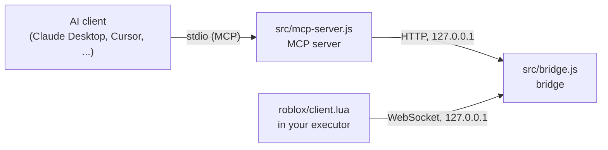

<p align="center">
  
</p>

<h1 align="center">Superbase</h1>

<p align="center">
  <strong>Let an AI assistant debug your live Roblox game.</strong>
</p>

Superbase is a local [Model Context Protocol](https://modelcontextprotocol.io) (MCP) server that connects AI assistants to a running Roblox session through your executor. The AI can read the console and script errors, search and inspect the instance tree, read scripts, change properties and run Lua, and it always knows whether Roblox is actually connected.

- **Zero configuration.** No token, no account, no copy and paste. Start the bridge, run one line in your executor, add the MCP server to your AI client.
- **Connection aware.** Every tool result starts with a status line. When the game is not connected, the AI gets the exact script you need to run and tells you.
- **11 tools** for logs, errors, inspection, scripts, properties and code execution.
- **Works with any MCP client** that supports stdio servers: Claude Desktop, Claude Code, Cursor, Windsurf, VS Code, Codex CLI, Antigravity and more.
- **Local only.** Everything listens on `127.0.0.1`. Web pages cannot reach it.
- **No dependencies** in the MCP server. The bridge needs only [`ws`](https://github.com/websockets/ws).

> **Warning.** Superbase lets an AI run code inside your game with your executor's full permissions. Only connect AI clients you trust. See [Security](#security).

## Contents

- [How it works](#how-it-works)
- [Requirements](#requirements)
- [Quick start](#quick-start)
- [Connect your AI client](#connect-your-ai-client)
- [Example prompts](#example-prompts)
- [Tools reference](#tools-reference)
- [Connection states](#connection-states)
- [The in-game client](#the-in-game-client)
- [Configuration](#configuration)
- [Token mode](#token-mode)
- [HTTP API](#http-api)
- [Security](#security)
- [Project layout](#project-layout)
- [Development](#development)
- [Troubleshooting](#troubleshooting)
- [FAQ](#faq)

## How it works

Three small programs talk to each other on your computer:



| Part | Role |
| --- | --- |
| `roblox/client.lua` | Runs in your executor. Streams console output and script errors to the bridge and answers commands (run code, inspect, ping). |
| `src/bridge.js` | Keeps the connection to the game, stores the last 1,000 logs and 1,000 errors, and offers a local HTTP API. It also serves `client.lua` so you can load it with `loadstring`. |
| `src/mcp-server.js` | Speaks MCP over stdio to your AI client and turns tool calls into bridge requests. It is started by the AI client, so you never run it by hand. |

Because the bridge stores logs, the AI can still read what happened after you leave the game.

## Requirements

- [Node.js](https://nodejs.org) 18 or newer
- A Roblox executor that supports `WebSocket.connect` and `loadstring`
- An AI client that supports MCP servers over stdio

Tested with Claude Desktop on Windows and the Solara executor. Other clients and executors should work, but they are not tested (see [Compatibility notes](#compatibility-notes)).

## Quick start

**1. Install and start the bridge**

```bash
git clone https://github.com/fiangg20/superbase.git
cd superbase
npm install
npm start
```

The bridge prints the loader for your executor:

```
[superbase] bridge 1.2.0 listening on ws://127.0.0.1:9731 (HTTP API on the same port)
[superbase] load the client in your executor with: loadstring(game:HttpGet("http://127.0.0.1:9731/client.lua"))()
```

**2. Load the client in your game**

Join a game and run this in your executor:

```lua
loadstring(game:HttpGet("http://127.0.0.1:9731/client.lua"))()
```

The intro plays, the console prints `[Superbase] Connected and authenticated` and a **Connected** notification appears in the top right corner.

If your executor blocks `HttpGet` to `localhost`, paste the contents of [`roblox/client.lua`](roblox/client.lua) into the executor instead.

**3. Add Superbase to your AI client**

Add the server to your client's MCP configuration (for Claude Desktop, see below for the other clients):

```json
{
  "mcpServers": {
    "superbase": {
      "command": "node",
      "args": ["C:\\path\\to\\superbase\\src\\mcp-server.js"]
    }
  }
}
```

Restart the client, then ask: *"Check the Roblox connection."* The AI calls `roblox_status` and answers.

You do not have to remember the loader line. While no game is connected, every tool result from the AI contains it, and the AI shows it to you.

## Connect your AI client

The command is always `node` with the absolute path to `src/mcp-server.js`. Use your own path in every example. If you changed the port, add `"env": { "SUPERBASE_PORT": "<port>" }`.

> The formats below follow each client's documented MCP configuration, which can change. If one does not work, check that client's own documentation.

<details>
<summary><strong>Claude Desktop</strong></summary>

Open **Settings → Developer → Edit Config**, or edit `claude_desktop_config.json` (on Windows usually in `%APPDATA%\Claude`). Restart Claude Desktop afterwards.

```json
{
  "mcpServers": {
    "superbase": {
      "command": "node",
      "args": ["C:\\path\\to\\superbase\\src\\mcp-server.js"]
    }
  }
}
```

If Claude Desktop keeps asking for permission, check the permission mode of the tool. Manual mode asks before every use of a new tool.

</details>

<details>
<summary><strong>Claude Code</strong></summary>

```bash
claude mcp add superbase -- node /path/to/superbase/src/mcp-server.js
```

</details>

<details>
<summary><strong>Cursor, Windsurf and Gemini CLI</strong></summary>

These clients use the same shape as Claude Desktop.

| Client | Config file |
| --- | --- |
| Cursor | `.cursor/mcp.json` (project) or `~/.cursor/mcp.json` (global) |
| Windsurf | `~/.codeium/windsurf/mcp_config.json` |
| Gemini CLI | `~/.gemini/settings.json` |

```json
{
  "mcpServers": {
    "superbase": {
      "command": "node",
      "args": ["/path/to/superbase/src/mcp-server.js"]
    }
  }
}
```

Since June 18, 2026 Gemini CLI no longer serves Google AI Pro, Ultra or free individual accounts. It still works with an API key or an enterprise license. Everyone else should use the Antigravity CLI.

</details>

<details>
<summary><strong>Antigravity</strong></summary>

Open the **…** menu at the top of the agent side panel, choose **MCP Servers**, then **Manage MCP Servers** and **View raw config**. That opens `mcp_config.json`. The documentation lists `~/.gemini/config/mcp_config.json` for all projects and `.agents/mcp_config.json` for a single workspace. In the Antigravity CLI, type `/mcp` to open the MCP manager, or edit the same file directly.

```json
{
  "mcpServers": {
    "superbase": {
      "command": "node",
      "args": ["/path/to/superbase/src/mcp-server.js"]
    }
  }
}
```

Click **Refresh** in Manage MCP Servers afterwards.

</details>

<details>
<summary><strong>VS Code</strong></summary>

Add this to `.vscode/mcp.json`:

```json
{
  "servers": {
    "superbase": {
      "type": "stdio",
      "command": "node",
      "args": ["/path/to/superbase/src/mcp-server.js"]
    }
  }
}
```

</details>

<details>
<summary><strong>Codex CLI</strong></summary>

Add this to `~/.codex/config.toml`:

```toml
[mcp_servers.superbase]
command = "node"
args = ["/path/to/superbase/src/mcp-server.js"]
```

</details>

**Clients that cannot use Superbase.** Superbase is local. Cloud hosted AI chats and mobile or web apps cannot reach `localhost`, so they cannot use it. An AI that has no MCP support but can run shell commands can use the [HTTP API](#http-api) directly.

## Example prompts

Once connected, you can ask things like:

- *"Check the Roblox connection."*
- *"Which game am I in, and who else is in the server?"*
- *"Show me the latest script errors and explain what causes them."*
- *"Find every RemoteEvent in ReplicatedStorage."*
- *"Read the source of `game.StarterPlayer.StarterPlayerScripts.CameraScript` and tell me what it does."*
- *"Set the Transparency of `game.Workspace.Door` to 0.5."*
- *"Run my code, then wait until the console prints `Loaded` and tell me what happened."*

## Tools reference

Every result starts with a status line, for example:

```
[Superbase] ● connected — place 123456, Solara 3.2, 12 ms
```

Tools marked **needs game** only run in the `connected` state. The others work as soon as the bridge is up, so the AI can still read stored logs and errors after you left the game.

### `roblox_status`

Pings the Roblox client and returns the connection state, place, executor, latency and the number of stored logs and errors. While `waiting_for_roblox` it also returns the `loader` script. Call it first. No parameters.

### `get_game_info` · needs game

Place name and creator, job id, the local player, the player list (up to 50) and performance (physics FPS, memory, ping). No parameters.

### `find_instances` · needs game

Searches the instance tree. At least one of `name` and `class_name` is required.

| Parameter | Type | Description |
| --- | --- | --- |
| `name` | string | Case-insensitive part of the instance name. |
| `class_name` | string | Class to match. Base classes work, for example `BasePart` or `LuaSourceContainer`. |
| `root` | string | Dotted path to search under. Default `game`. |
| `limit` | integer | Maximum results, 1–200. Default 50. |

Returns the full path and class of each match and whether the list was cut off.

### `inspect_instance` · needs game

Reads one instance.

| Parameter | Type | Description |
| --- | --- | --- |
| `path` | string | Dotted path starting at `game`. Default `game`. |
| `properties` | string[] | Property names to read. Default `Name`, `ClassName`, `Parent`. |

Returns the class, the requested properties and up to 100 children.

### `get_script_source` · needs game

Reads the source of a `Script`, `LocalScript` or `ModuleScript`. It uses the executor's `decompile` when available and falls back to the `Source` property.

| Parameter | Type | Description |
| --- | --- | --- |
| `path` | string | **Required.** Dotted path to the script. |
| `max_chars` | integer | 100–40000. Default 20000. Longer sources are cut and marked `truncated`. |

### `set_property` · needs game

Sets a property on an instance. This changes the game on your client, so it only replicates where Roblox allows it. Returns the old and the new value.

| Parameter | Type | Description |
| --- | --- | --- |
| `path` | string | **Required.** Dotted path to the instance. |
| `property` | string | **Required.** Property name, for example `Transparency`. |
| `value_json` | string | **Required.** The new value as JSON text. |

Supported values:

| Value | `value_json` |
| --- | --- |
| String | `"\"Hello\""` |
| Number | `"0.5"` |
| Boolean | `"false"` |
| `Vector3` | `{"type":"Vector3","x":1,"y":2,"z":3}` |
| `Vector2` | `{"type":"Vector2","x":1,"y":2}` |
| `Color3` (0–255) | `{"type":"Color3","r":255,"g":0,"b":0}` |
| `Enum` | `{"type":"Enum","enum":"Material","name":"Neon"}` |
| Instance | `{"type":"Instance","path":"game.Workspace.Part"}` |

`null` is not accepted. Use `execute_lua` to set a property to `nil`.

### `execute_lua` · needs game

Runs Lua in the executor and returns the serialized return values, or the error with a traceback.

| Parameter | Type | Description |
| --- | --- | --- |
| `code` | string | **Required.** Lua source. Use `return` to get a value back. |
| `capture_logs` | boolean | Also return the console lines and script errors produced during the run. Default `false`. |
| `wait_ms` | integer | With `capture_logs`: how long to keep collecting after the code finished, 0–5000. Default 500. |

Tables are serialized up to 4 levels deep and 50 entries per table. Strings are cut at 60,000 characters.

### `get_logs`

Reads stored console output. The newest entries come last. The result contains a `now` timestamp you can pass as `since` next time.

| Parameter | Type | Description |
| --- | --- | --- |
| `limit` | integer | 1–1000. Default 100. |
| `level` | string | `info`, `warn` or `error`. |
| `contains` | string | Case-insensitive text filter. |
| `since` | integer | Only entries from this timestamp (milliseconds) onward. |

### `get_errors`

Reads stored script errors with the stack trace and the script path.

| Parameter | Type | Description |
| --- | --- | --- |
| `limit` | integer | 1–1000. Default 50. |
| `contains` | string | Case-insensitive filter on the message and the trace. |
| `since` | integer | Only errors from this timestamp (milliseconds) onward. |

### `wait_for_log`

Waits until a **new** console line (or script error) that contains some text appears, then returns it. Lines that were already stored when the call started do not count. A timeout is a normal result (`matched: false`), not an error.

| Parameter | Type | Description |
| --- | --- | --- |
| `contains` | string | **Required.** Text to wait for. |
| `timeout_ms` | integer | 100–30000. Default 10000. |
| `level` | string | Only match console lines of this level. |
| `include_errors` | boolean | Also match script errors. Default `true`. |

### `clear_logs`

Clears the stored logs and errors. No parameters.

### Limits

| Limit | Value |
| --- | --- |
| Stored logs / errors | 1,000 each (oldest are dropped) |
| Command timeout | 15 seconds |
| Ping timeout | 3 seconds |
| Result size shown to the AI | 50,000 characters |
| Instance names | Names that contain a `.` cannot be addressed by path |

## Connection states

The AI always knows which state it is in, because the first line of every result shows it.

| State | Status line | Meaning | What the AI does |
| --- | --- | --- | --- |
| `connected` | `●` | A client is connected and answered a ping. | Everything works. |
| `waiting_for_roblox` | `○` | The bridge runs, but no game is connected. | Shows you the `loadstring` script and waits. |
| `unresponsive` | `○` | A client is connected but did not answer a ping. | Tells you the game may be frozen, loading or closing. |
| `bridge_offline` | `○` | The bridge is not running. | Asks you to run `npm start`. |
| `token_mismatch` | `○` | The bridge needs a token and the MCP config has none, or a different one. | Asks you to fix `BRIDGE_TOKEN` in the MCP config. |

When the state is not `connected`, tools that need the game are not run, and the AI is told not to retry in a loop.

The bridge pings the client every 10 seconds and drops it after 30 seconds of silence, so a force closed game does not look connected.

## The in-game client

`roblox/client.lua` does more than relay messages.

**Intro.** A short animated intro plays when the client starts. It does not delay the connection.

**Notifications.** Small toasts appear in the top right corner:

| Notification | When |
| --- | --- |
| Connected / Reconnected | The bridge accepted the client. |
| Disconnected | The connection was lost. The client keeps retrying. |
| Bridge not found | The bridge is not running. Shown once, not on every retry. |
| Bridge closed the connection | Usually a token problem. |
| AI activity | The AI ran code or inspected an instance (at most once every 3 seconds). |

Toasts wait for the intro to finish.

**Re-running is safe.** Running the script again stops the previous instance first (including the older DebugBridge build), so connections do not stack.

### Client settings

Edit the `CONFIG` table at the top of `roblox/client.lua`.

| Option | Default | Description |
| --- | --- | --- |
| `Url` | `ws://127.0.0.1:9731` | Bridge address. The loader from the bridge already has the right port. |
| `Token` | `""` | Only needed in [token mode](#token-mode). |
| `ReconnectDelay` | `3` | Seconds between reconnect attempts. |
| `Notifications` | `true` | Show status notifications. |
| `NotifyActivity` | `true` | Also notify when the AI runs code or inspects something. |
| `ActivityCooldown` | `3` | Minimum seconds between activity notifications. |
| `ToastTime` | `4` | Seconds a notification stays on screen. |
| `MaxToasts` | `4` | Notifications visible at once. |
| `Intro.Enabled` | `true` | Play the intro. |
| `Intro.*` | | Icon, color, timing, blur and swipe settings of the intro. |
| `HistoryLines` | `100` | Console history sent when connecting. |
| `MaxMessageLength` | `4000` | Longest console message sent. |
| `MaxResultLength` | `60000` | Longest string returned from `execute_lua`. |
| `MaxTableEntries` / `MaxDepth` | `50` / `4` | Limits when serializing tables. |

## Configuration

Environment variables. Set them for the process that uses them: the bridge is started by you, the MCP server by your AI client (use the `env` field of its config).

| Variable | Used by | Default | Description |
| --- | --- | --- | --- |
| `SUPERBASE_PORT` (or `BRIDGE_PORT`) | bridge, MCP server | `9731` | Port of the bridge. Must be the same for both. |
| `SUPERBASE_TOKEN` (or `BRIDGE_TOKEN`) | bridge, MCP server | none | Enables [token mode](#token-mode). At least 16 characters. |
| `SUPERBASE_CLIENT_URL` | MCP server | the bridge's `/client.lua` | URL used in the `loadstring` script, for example a public raw GitHub link. |
| `SUPERBASE_PING_MS` | bridge | `10000` | Heartbeat interval. |
| `SUPERBASE_STALE_MS` | bridge | `30000` | Drop a client that was silent this long. |

To change the port, set `SUPERBASE_PORT` when you start the bridge and in the `env` of your MCP config, then use the loader the bridge prints. Example for PowerShell: `$env:SUPERBASE_PORT="9800"; npm start`.

## Token mode

By default the bridge needs no token. If you want one anyway, for example because other programs run on your computer that you do not trust:

1. Generate a token: `node -e "console.log(require('crypto').randomBytes(24).toString('hex'))"`
2. Start the bridge with it. PowerShell: `$env:BRIDGE_TOKEN="<token>"; npm start`. macOS or Linux: `BRIDGE_TOKEN=<token> npm start`.
3. Add it to your MCP config: `"env": { "BRIDGE_TOKEN": "<token>" }`.
4. Copy `roblox/client.lua` into your executor and set `CONFIG.Token` to the same token.

In token mode `/client.lua` is not served, so there is no `loadstring` loader. Never commit a real token.

## HTTP API

The MCP server uses this API, and so can your own tools. In open mode every request needs a header named `x-superbase-client` (any value). In token mode it needs `x-bridge-token: <token>` instead. `GET /client.lua` needs neither.

| Request | Purpose |
| --- | --- |
| `GET /client.lua` | The executor client with its URL set to this bridge. Open mode only. |
| `GET /status` | Connection info. Add `?probe=1` to ping the client first. |
| `GET /logs` | Stored console output. Query: `limit`, `level`, `contains`, `since`. |
| `GET /errors` | Stored script errors. Query: `limit`, `contains`, `since`. |
| `POST /exec` | Run Lua. Body: `{ "code": "return 1" }`. |
| `POST /inspect` | Inspect an instance. Body: `{ "path": "game.Workspace", "properties": ["Name"] }`. |
| `POST /clear` | Clear stored logs and errors. |

Example:

```bash
curl -H "x-superbase-client: curl" "http://127.0.0.1:9731/status?probe=1"
```

## Security

Superbase gives an AI the same power over your game client as your executor has. Read this section before you use it.

- **Code execution.** `execute_lua` and `set_property` run code inside your executor. Review what the AI wants to run before you approve it, and only connect clients you trust.
- **Local only.** The bridge binds to `127.0.0.1`. Never expose the port to a network or the internet.
- **Web pages are blocked.** The bridge checks the `Host` header, rejects any HTTP request or WebSocket connection that carries a foreign `Origin`, never approves a CORS preflight and requires a custom header on every API call. A web page you visit cannot reach it.
- **Other programs are not blocked in open mode.** Without a token, any program running on your computer can use the bridge. Use [token mode](#token-mode) if that matters to you.
- **Keep tokens private.** Anyone who has the token and can reach the port can run code in your game. Never commit one.
- **Use it in your own games.** Running code in other people's games can break their rules. You are responsible for where you use Superbase.

## Project layout

```
superbase/
├── src/
│   ├── bridge.js           WebSocket server and local HTTP API
│   ├── mcp-server.js       MCP server (stdio), no dependencies
│   └── lua/                Lua snippets behind the higher level tools
│       ├── game_info.lua
│       ├── find_instances.lua
│       ├── get_script_source.lua
│       └── set_property.lua
├── roblox/
│   └── client.lua          Runs in the executor
├── test/
│   ├── bridge.test.js
│   └── mcp-server.test.js
├── package.json
└── README.md
```

## Development

```bash
npm install
npm test
```

The tests start the bridge, the MCP server and a fake executor, and cover every connection state, every tool, the open and token modes and the protection against web pages.

The Lua files (`roblox/client.lua` and `src/lua/*.lua`) need a real executor, so they are **not** covered by the tests. Test changes to them in a game.

To add a tool that runs Lua in the game, put the code in `src/lua/<name>.lua` (it receives its arguments as a table named `args` and returns a table, or `{ error = "..." }` to fail), then add the tool definition in `src/mcp-server.js` and call `runSnippet("<name>", args)`.

### Compatibility notes

- The MCP server targets protocol versions 2025-06-18, 2025-03-26 and 2024-11-05.
- Executors differ. `decompile`, `identifyexecutor` and the WebSocket API are optional or named differently in some of them, and the client falls back where it can.
- `UIShadow` (used by the intro) is not available everywhere. The intro skips it when it is missing.

## Troubleshooting

| Symptom | Cause and fix |
| --- | --- |
| `Cannot find module 'ws'` | Run `npm install` in the Superbase folder. |
| The loader fails in the executor | The executor may block `HttpGet` to `localhost`. Paste `roblox/client.lua` into the executor instead. |
| Executor console shows `401 Unauthorized`, or a "Bridge closed the connection" notification | The bridge was started with `BRIDGE_TOKEN`. Set `CONFIG.Token` in `client.lua` to the same value, or restart the bridge without a token. |
| `Unable to connect`, or a "Bridge not found" notification | The bridge is not running, or the port differs from `CONFIG.Url`. |
| The port is already in use | Pick another port: set `SUPERBASE_PORT` for the bridge and the MCP server, then use the loader the bridge prints. |
| The AI says `bridge_offline` | Start the bridge with `npm start`. |
| The AI says `waiting_for_roblox` | The client stops when you leave or rejoin a game. Run the loader again, or put it in your executor's autoexec folder. |
| The AI says `unresponsive` | The game is frozen, still loading or closing. Wait, or rejoin and run the loader again. |
| The AI says `token_mismatch` | The MCP config token and the bridge token differ. Make them the same, or run the bridge without a token. |
| The AI client does not list Superbase | Check the path in the config, restart the client and confirm that Node.js 18+ is installed (`node --version`). |
| Claude Desktop asks for confirmation on every call | The tool permission mode is set to ask. Change it in the tool's permission settings. |

## FAQ

**Do I need Claude Code?**
No. Any MCP client that supports stdio servers works.

**Does it work from my phone?**
No. The MCP server runs on your computer, so the AI client must run there too. Mobile and web apps cannot reach `localhost`.

**Do I need a token?**
No. Open mode works without one and still blocks web pages. Use [token mode](#token-mode) if you want other programs on your computer to be locked out as well.

**Can it change things on the server?**
Not by itself. Code runs on your client. Server side effects are possible only where the game itself exposes them, for example through a RemoteEvent that you own and that accepts code, which is your decision in your own game.

**Does it work in every game?**
It works wherever your executor can run scripts. Some games detect or block executors, and that is outside the control of Superbase.

**Is it affiliated with Roblox?**
No. Superbase is an independent project.
